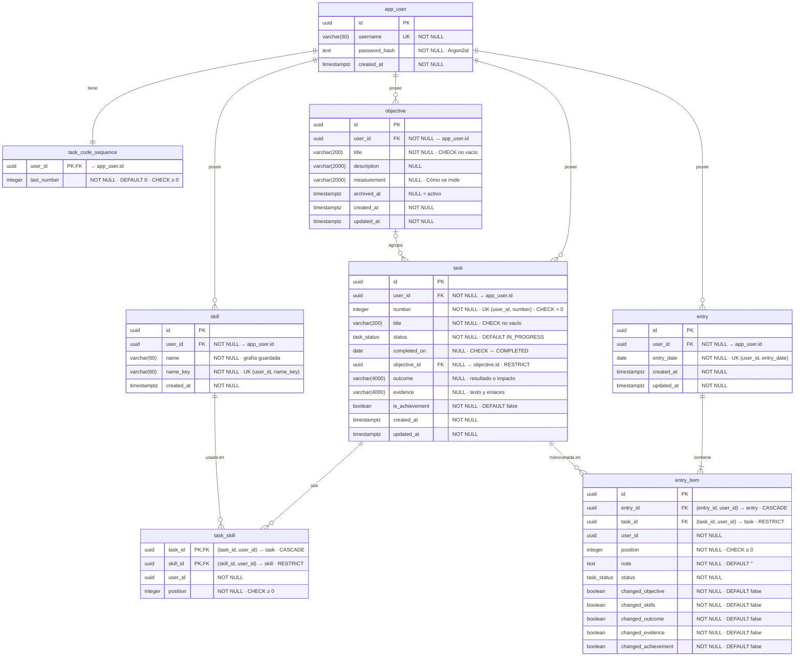

## Índice

0. [Ficha del proyecto](#0-ficha-del-proyecto)
1. [Descripción general del producto](#1-descripción-general-del-producto)
2. [Arquitectura del sistema](#2-arquitectura-del-sistema)
3. [Modelo de datos](#3-modelo-de-datos)
4. [Especificación de la API](#4-especificación-de-la-api)
5. [Historias de usuario](#5-historias-de-usuario)
6. [Tickets de trabajo](#6-tickets-de-trabajo)
7. [Pull requests](#7-pull-requests)

---

## 0. Ficha del proyecto

### **0.1. Tu nombre completo:**

### **0.2. Nombre del proyecto:**

### **0.3. Descripción breve del proyecto:**

### **0.4. URL del proyecto:**

> Puede ser pública o privada, en cuyo caso deberás compartir los accesos de manera segura. Puedes enviarlos a [alvaro@lidr.co](mailto:alvaro@lidr.co) usando algún servicio como [onetimesecret](https://onetimesecret.com/).

### 0.5. URL o archivo comprimido del repositorio

> Puedes tenerlo alojado en público o en privado, en cuyo caso deberás compartir los accesos de manera segura. Puedes enviarlos a [alvaro@lidr.co](mailto:alvaro@lidr.co) usando algún servicio como [onetimesecret](https://onetimesecret.com/). También puedes compartir por correo un archivo zip con el contenido

---

## 1. Descripción general del producto

> Describe en detalle los siguientes aspectos del producto:

### **1.1. Objetivo:**

Diario de trabajo es una aplicación web personal para registrar a diario las tareas trabajadas, su estado y su resultado, y generar a partir de ese historial el informe de la reunión semestral de evaluación de objetivos (resumen, logros destacados, fortalezas por competencia y detalle por objetivo), listo para exportar y llevar a la reunión.

Soluciona el problema de reconstruir de memoria seis meses de trabajo repartido entre tickets, correos, chats y notas sueltas justo antes de cada reunión de evaluación: con ese método, los logros de los primeros meses se olvidan o se cuentan sin su resultado ni sus evidencias, no queda un vínculo claro entre el trabajo hecho y los objetivos acordados, y las fortalezas se describen con impresiones generales en lugar de con un recuento real de en qué tareas se usó cada competencia.

Está pensado para una sola usuaria: la propietaria del diario, una profesional que registra su propio trabajo y tiene evaluaciones de objetivos cada semestre. Es una herramienta personal, no colaborativa — responsables, compañeros y equipos de RR. HH. no tienen acceso a la aplicación; el informe les llega solo como fichero exportado que la propietaria decide enviar.

### **1.2. Características y funcionalidades principales:**

**Must-have:**

- **Registro diario de entradas:** una entrada por fecha (hoy por defecto) con una o varias tareas; cada una lleva una tarea existente o nueva, una nota opcional y el estado tras ese día, y puede completarse con objetivo, competencias, resultado, evidencias y marca de logro. Guardar en una fecha que ya tiene entrada fusiona sus elementos; la misma tarea no puede repetirse en una entrada.
- **Historial cronológico:** listado de entradas por fecha descendente, agrupado por mes, con acceso directo a cada tarea desde su identificador.
- **Seguimiento y edición de tareas:** lista de tareas con ID estable (`T-001`, `T-002`…) ordenada por actividad reciente, con su línea de tiempo y edición en línea de todos sus datos.
- **Gestión de objetivos:** crear, editar, archivar y restaurar objetivos, cada uno con sus contadores de tareas, completadas y logros.
- **Informe del periodo y exportación en Markdown:** informe de los últimos 6 meses, de un semestre del año en curso o de un rango personalizado, con resumen, logros destacados, fortalezas por competencia y detalle por objetivo; vista previa, copia al portapapeles y descarga en `.md`, con exportación determinista.

**Should-have (opcionales):**

- **Exportación del informe en PDF:** la misma exportación del informe como PDF A4, con título, periodo y numeración de páginas.
- **Búsqueda y filtros de tareas:** búsqueda de texto libre y filtros por estado, objetivo, competencia y "Solo logros" en la pestaña Tareas.

Detalle completo de cada funcionalidad, requisitos y criterios de aceptación en [`docs/prd/alcance-mvp.md`](docs/prd/alcance-mvp.md) y [`docs/prd/mvp.md`](docs/prd/mvp.md).

### **1.3. Diseño y experiencia de usuario:**

> Proporciona imágenes y/o videotutorial mostrando la experiencia del usuario desde que aterriza en la aplicación, pasando por todas las funcionalidades principales.

### **1.4. Instrucciones de instalación:**

> Documenta de manera precisa las instrucciones para instalar y poner en marcha el proyecto en local (librerías, backend, frontend, servidor, base de datos, migraciones y semillas de datos, etc.)

---

## 2. Arquitectura del Sistema

### **2.1. Diagrama de arquitectura:**

La aplicación es una **SPA con API REST** en tres contenedores: `web` (React servido por nginx), `api` (NestJS) y `postgres`. El navegador ve un **único origen**: los estáticos se sirven en `/` y la API en `/api`.


En local se levanta con `docker compose`; en la nube, en Kubernetes (DOKS) con `Deployment` para `web` y `api`, `StatefulSet` + `PersistentVolumeClaim` para PostgreSQL e `Ingress` con TLS. GitHub Actions construye y publica las imágenes; el despliegue al clúster es manual.

**Patrón.** El backend sigue **Clean Architecture** (dominio → aplicación → infraestructura/interfaz), con las dependencias siempre hacia dentro: el dominio y los casos de uso son TypeScript puro y no importan `@nestjs/*` ni `@prisma/client`. La inyección de dependencias de NestJS conecta los puertos del dominio con sus adaptadores de Prisma. En el frontend no se replica la separación formal, pero la lógica que no es de interfaz vive en funciones y hooks puros.

**Por qué esta arquitectura.** El producto es pequeño (una usuaria, unos cientos de entradas al año) pero tiene reglas de integridad estrictas con test propio en el PRD: fusión de entradas en la misma fecha, protección por fecha al rellenar días pasados, recálculo de estados al eliminar, IDs de tarea secuenciales sin duplicados con peticiones simultáneas y un informe exportado idéntico byte a byte. La arquitectura se elige para que esas reglas vivan en un único sitio, se prueben sin infraestructura y se cumplan "por cualquier camino".

**Beneficios:**

- **Reglas comprobables con TDD:** el dominio se prueba con tests unitarios puros, usando los ejemplos de aceptación del PRD como casos, sin arrancar Nest ni una base de datos.
- **Integridad garantizada en el servidor:** cada caso de uso es una transacción; las reglas se refuerzan con restricciones de PostgreSQL (`UNIQUE`, `CHECK`, `ON DELETE RESTRICT`). El frontend nunca replica reglas: invalida y vuelve a leer.
- **Informe determinista:** el informe y su Markdown se generan con funciones puras del dominio, con orden total y sin depender del reloj.
- **Seguridad sencilla:** mismo origen, cookie `HttpOnly` + `SameSite=Strict`, sin CORS; el `userId` sale solo de la sesión y es parámetro obligatorio de cada repositorio (aislamiento entre usuarias).
- **Contratos compartidos:** un mismo esquema zod valida en el backend y tipa el frontend.
- **Despliegue reproducible:** las mismas imágenes en `docker compose` (revisor externo) y en Kubernetes.

**Sacrificios y déficits:**

- **Más código de lo estrictamente necesario:** cada caso de uso tiene su puerto además de la implementación con Prisma; para un MVP de este tamaño, llamar a Prisma desde los servicios sería más corto.
- **Disciplina de capas:** hay que mantener los límites de importación (se refuerzan con ESLint) o la arquitectura se degrada.
- **Dos runners de test:** Jest en el backend (idiomático en Nest) y Vitest en el frontend.
- **PostgreSQL dentro del clúster:** decisión consciente para practicar `StatefulSet`; sin copias de seguridad, se mitiga con un _seed_ idempotente y datos ficticios.
- **"Hoy" lo pone el navegador:** el cliente envía su fecha local (`X-Client-Date`) y el servidor solo la acepta a ±1 día de su fecha UTC; es una pequeña complejidad añadida para respetar la zona horaria de la usuaria.
- **Sin escalado horizontal ni observabilidad completa:** desproporcionados para una sola usuaria; se dejan fuera de forma explícita.

Detalle completo (diagramas de contexto, capas, secuencia, datos, despliegue y CI) en [`docs/arquitectura.md`](docs/arquitectura.md); decisiones de stack y prácticas en [`docs/adr/0001-stack-tecnologico.md`](docs/adr/0001-stack-tecnologico.md) y [`docs/adr/0002-practicas-de-ingenieria.md`](docs/adr/0002-practicas-de-ingenieria.md).

### **2.2. Descripción de componentes principales:**

| Componente                                 | Tecnología                                                   | Responsabilidad                                                                                                                                                                                                          |
| ------------------------------------------ | ------------------------------------------------------------ | ------------------------------------------------------------------------------------------------------------------------------------------------------------------------------------------------------------------------ |
| **Frontend (`apps/web`)**                  | React + Vite, TanStack Query, TypeScript; servido por nginx  | Las cuatro pestañas (Diario, Tareas, Objetivos, Informe), cabecera con resumen en vivo, mensajes y confirmaciones en la página, tema claro/oscuro y diseño adaptado a pantallas estrechas. Genera el PDF en el navegador |
| **API REST (`apps/api`)**                  | NestJS sobre Node.js, TypeScript                             | Expone `/api` (entradas, tareas, objetivos, competencias, resumen, informe, autenticación) y traduce HTTP a casos de uso                                                                                                 |
| ↳ Capa de dominio                          | TypeScript puro                                              | Entidades (`Entry`, `Task`, `Objective`…), `CalendarDate` y las reglas: `EntryMerger` (fusión), `TaskStateProjector` (protección por fecha y recálculo), `SkillNormalizer`, `ReportBuilder` y `MarkdownRenderer`         |
| ↳ Capa de aplicación                       | TypeScript puro                                              | Un caso de uso por operación (`SaveDailyEntry`, `DeleteEntry`, `UpdateTask`, `GeneratePeriodReport`…), cada uno en una transacción a través del puerto `UnitOfWork`                                                      |
| ↳ Capa de infraestructura                  | Prisma, `express-session` + `connect-pg-simple`, Argon2      | Repositorios sobre PostgreSQL, secuencia atómica de ID de tarea por usuaria, almacén de sesiones y hash de contraseñas                                                                                                   |
| ↳ Capa de interfaz                         | Controllers, guards y pipes de NestJS, `@nestjs/throttler`   | `SessionGuard` (`401` sin sesión, caducidad a los 30 min), validación con zod, límite de intentos de login y traducción de errores de dominio a HTTP                                                                     |
| **Paquete compartido (`packages/shared`)** | TypeScript, zod                                              | Esquemas y tipos de los DTO, enumeraciones y utilidades de fechas de calendario (`CalendarDate`, cálculo del periodo) usados por los dos lados                                                                           |
| **Base de datos**                          | PostgreSQL                                                   | Datos del diario y sesiones; restricciones de unicidad, `CHECK` y `RESTRICT` como red de seguridad de las reglas; _seed_ idempotente con dos usuarias de prueba                                                          |
| **Contenedores y orquestación**            | Docker, `docker compose`, Kubernetes (DOKS), ingress-nginx   | Entorno local reproducible para el revisor y despliegue en la nube (`Deployment`, `StatefulSet` + `PVC`, `Ingress`, `Job` de migraciones y _seed_)                                                                       |
| **CI**                                     | GitHub Actions, GHCR                                         | Lint, tests (Jest, Vitest, Playwright), `pnpm audit`, construcción y publicación de las imágenes de `api` y `web`                                                                                                        |
| **Tests**                                  | Jest + supertest, Vitest + React Testing Library, Playwright | Unitarios de dominio, integración contra PostgreSQL real, contrato HTTP, componentes y E2E del flujo principal                                                                                                           |

### **2.3. Descripción de alto nivel del proyecto y estructura de ficheros**

> Representa la estructura del proyecto y explica brevemente el propósito de las carpetas principales, así como si obedece a algún patrón o arquitectura específica.

### **2.4. Infraestructura y despliegue**

> Detalla la infraestructura del proyecto, incluyendo un diagrama en el formato que creas conveniente, y explica el proceso de despliegue que se sigue

### **2.5. Seguridad**

> Enumera y describe las prácticas de seguridad principales que se han implementado en el proyecto, añadiendo ejemplos si procede

### **2.6. Tests**

> Describe brevemente algunos de los tests realizados

---

## 3. Modelo de Datos

### **3.1. Diagrama del modelo de datos:**

PostgreSQL, gestionado con Prisma. Todas las tablas del diario llevan `user_id` (aislamiento por usuaria, RF-3); las tablas de relación usan claves foráneas compuestas `(x_id, user_id)` para que la base rechace mezclar registros de dos usuarias. Las fechas de calendario son `date`, sin hora (RNF-4).



Además existe la tabla `session` de `connect-pg-simple` (`sid` PK, `sess json`, `expire timestamp`), sin relaciones con las demás.

### **3.2. Descripción de entidades principales:**

| Tabla                | Qué representa                                                                                                       | Restricciones clave                                                                                                                                                      |
| -------------------- | -------------------------------------------------------------------------------------------------------------------- | ------------------------------------------------------------------------------------------------------------------------------------------------------------------------ |
| `app_user`           | Cuenta de usuaria; solo las dos del _seed_, sin registro                                                             | `username` único; contraseña solo como hash Argon2id                                                                                                                     |
| `task_code_sequence` | Último número de tarea asignado a cada usuaria                                                                       | Se incrementa con `UPDATE … RETURNING` en la misma transacción que crea la tarea; nunca baja, así que los ID borrados no se reutilizan (RF-15)                           |
| `objective`          | Meta del periodo de evaluación: título, descripción y "Cómo se mide"                                                 | Título obligatorio, no único; `archived_at` marca el archivado sin perder las tareas (RF-28); no se borra si tiene tareas (`RESTRICT`, RF-30)                            |
| `task`               | Trabajo seguido en el tiempo; su ID visible `T-003` se forma a partir de `number`                                    | `UNIQUE (user_id, number)` (RF-15); `CHECK` estado `COMPLETED` ⇔ `completed_on` no nulo (RF-24); no se borra si alguna entrada la menciona (`RESTRICT`, RF-25)           |
| `skill`              | Competencia de la usuaria, con su grafía y una clave normalizada (recortada y en minúsculas)                         | `UNIQUE (user_id, name_key)`: "kubernetes" reutiliza "Kubernetes" (RF-13); se borra cuando ninguna tarea la usa                                                          |
| `task_skill`         | Competencias que usa cada tarea, en el orden en que se introdujeron                                                  | Clave primaria `(task_id, skill_id)`: sin duplicados en una tarea                                                                                                        |
| `entry`              | El diario de un día concreto                                                                                         | `UNIQUE (user_id, entry_date)`: una entrada por fecha; guardar en una fecha existente fusiona (RF-10)                                                                    |
| `entry_item`         | Una tarea dentro de una entrada: nota, estado tras ese día y qué datos de la tarea cambió ese guardado (`changed_*`) | `UNIQUE (entry_id, task_id)` (RF-11); las marcas `changed_*` implementan la protección por fecha de RF-12: un dato solo se aplica si ninguna entrada posterior lo cambió |

Lo derivable no se guarda: la última actividad y el número de entradas de cada tarea, los contadores de objetivo, el resumen de la cabecera y el informe se calculan en cada consulta (RNF-3: 300 entradas, 600 tareas).

Detalle completo (columnas, tipos, `schema.prisma`, `CHECK` complementarios, consultas que sostienen cada regla, índices, _seed_ y decisiones DM-1 a DM-8) en [`docs/modelo-de-datos.md`](docs/modelo-de-datos.md).

---

## 4. Especificación de la API

API REST en JSON bajo `/api`, en el mismo origen que la SPA. La especificación completa (21 operaciones: autenticación, resumen, entradas, tareas, objetivos, competencias, informe y _health_) está en [`docs/api/openapi.yaml`](docs/api/openapi.yaml) (OpenAPI 3.1). Es la fuente de verdad del contrato: los esquemas zod de `packages/shared` la implementan y los tests de contrato la comprueban.

Convenciones comunes:

- **Sesión**: cookie `sid` (`HttpOnly`, `SameSite=Strict`) que crea `POST /auth/login` y caduca a los 30 min de inactividad. Todo exige sesión salvo `login` y `health` (`401`). La usuaria sale solo de la sesión; un recurso de otra usuaria responde `404`, igual que uno inexistente (RF-3).
- **Fechas** como `AAAA-MM-DD`, sin hora. **Identificadores públicos**: la fecha para la entrada, el código `T-003` para la tarea y el UUID para el objetivo.
- **`X-Client-Date`**: la SPA envía su fecha local ("hoy", RNF-4) en cada escritura; el servidor la acepta a ±1 día de su fecha UTC.
- **Errores**: `{ "code", "message", "details"? }` con un código estable (`VALIDATION_FAILED`, `NOT_FOUND`, `TASK_HAS_ENTRIES`, `ENTRY_DATE_IN_FUTURE`…). Cada escritura es una transacción: se aplica entera o nada (RNF-5).

Los tres endpoints principales, que concentran las reglas centrales del producto (extracto de `docs/api/openapi.yaml`; los esquemas referenciados están definidos allí):

```yaml
paths:
  /entries/{date}:
    put:
      operationId: saveDailyEntry
      summary: Save the entry of a date (create or merge)
      description: >
        Creates the entry of `date` or merges the items into the existing one (RF-10).
        `date` must not be after X-Client-Date (RF-7). The submitted items must not repeat
        a task (RF-11). Status and each detail field present in an item are applied to the
        task only if no later-dated entry mentions the task / changed that field (RF-12);
        absent detail fields are left untouched.
      parameters:
        - {
            name: date,
            in: path,
            required: true,
            schema: { $ref: "#/components/schemas/CalendarDate" },
          }
        - {
            name: X-Client-Date,
            in: header,
            required: true,
            schema: { $ref: "#/components/schemas/CalendarDate" },
          }
      requestBody:
        required: true
        content:
          application/json:
            schema: { $ref: "#/components/schemas/SaveEntryRequest" }
      responses:
        "200":
          {
            description: Saved (possibly merged) entry,
            content:
              {
                application/json:
                  { schema: { $ref: "#/components/schemas/Entry" } },
              },
          }
        "400": { description: VALIDATION_FAILED or CLIENT_DATE_INVALID }
        "401": { description: UNAUTHENTICATED }
        "404": { description: Referenced task or objective not found }
        "422": { description: ENTRY_DATE_IN_FUTURE or DUPLICATE_TASK_IN_ENTRY }

  /tasks/{code}:
    patch:
      operationId: updateTask
      summary: Edit a task inline
      description: >
        Partial update (RF-22). To COMPLETED, completedOn = last activity date, or
        X-Client-Date if the task has no entries; leaving COMPLETED clears it (RF-23, RF-24).
        Creates no entry item and never triggers the RF-12 protection.
      parameters:
        - {
            name: code,
            in: path,
            required: true,
            schema: { $ref: "#/components/schemas/TaskCode" },
          }
        - {
            name: X-Client-Date,
            in: header,
            required: true,
            schema: { $ref: "#/components/schemas/CalendarDate" },
          }
      requestBody:
        required: true
        content:
          application/json:
            schema: { $ref: "#/components/schemas/UpdateTaskRequest" }
      responses:
        "200":
          {
            description: Updated task,
            content:
              {
                application/json:
                  { schema: { $ref: "#/components/schemas/Task" } },
              },
          }
        "400": { description: VALIDATION_FAILED or CLIENT_DATE_INVALID }
        "401": { description: UNAUTHENTICATED }
        "404": { description: Task or objective not found }

  /reports:
    get:
      operationId: generatePeriodReport
      summary: Period report and its Markdown
      description: >
        Report of the inclusive range [from, to] (RF-33…RF-36) with every list in its final
        order, plus the Markdown export, byte-identical for the same data and period (RF-39).
      parameters:
        - {
            name: from,
            in: query,
            required: true,
            schema: { $ref: "#/components/schemas/CalendarDate" },
          }
        - {
            name: to,
            in: query,
            required: true,
            schema: { $ref: "#/components/schemas/CalendarDate" },
          }
      responses:
        "200":
          {
            description: Report,
            content:
              {
                application/json:
                  { schema: { $ref: "#/components/schemas/Report" } },
              },
          }
        "400": { description: Missing or invalid dates, or from > to }
        "401": { description: UNAUTHENTICATED }
```

**Ejemplo 1 — guardar la entrada del 2026-11-19** con una tarea existente que se completa como logro y una tarea nueva con un objetivo nuevo:

```http
PUT /api/entries/2026-11-19
Content-Type: application/json
X-Client-Date: 2026-11-23
Cookie: sid=…

{
  "items": [
    {
      "task": { "code": "T-004" },
      "note": "Postmortem redactado y compartido con el equipo.",
      "status": "COMPLETED",
      "isAchievement": true,
      "outcome": "Reducción del 25% de las conexiones simultáneas en las instancias tomcat TOMCAT-1",
      "evidence": "https://wiki.interna/postmortems/TOMCAT-1"
    },
    {
      "task": { "title": "Revisar la política de copias de seguridad" },
      "status": "IN_PROGRESS",
      "objective": { "title": "Fiabilidad de la plataforma" },
      "skills": ["kubernetes", "Copias de seguridad"]
    }
  ]
}
```

```http
HTTP/1.1 200 OK
Content-Type: application/json

{
  "date": "2026-11-19",
  "items": [
    {
      "task": {
        "code": "T-004", "title": "Incidente instancia tomcat TOMCAT-1",
        "status": "COMPLETED", "isAchievement": true,
        "objective": { "id": "3f1c2a9e-5b7d-4c1e-9a2f-8d6e4b0c7a11", "title": "Mantenimiento del servicio de portales del proyecto PROYECTO-1", "archived": false },
        "skills": ["Resolución de incidencias"]
      },
      "note": "Postmortem redactado y compartido con el equipo.",
      "status": "COMPLETED"
    },
    {
      "task": {
        "code": "T-010", "title": "Revisar la política de copias de seguridad",
        "status": "IN_PROGRESS", "isAchievement": false,
        "objective": { "id": "9b0e7d3c-2a41-4f6e-8c5d-1e2f3a4b5c6d", "title": "Fiabilidad de la plataforma", "archived": false },
        "skills": ["Kubernetes", "Copias de seguridad"]
      },
      "note": "",
      "status": "IN_PROGRESS"
    }
  ]
}
```

La tarea nueva recibe el siguiente código de la usuaria (`T-010`, RF-15) y `"kubernetes"` se guarda con la grafía ya existente, `"Kubernetes"` (RF-13). Si la fecha ya tenía entrada, los elementos se fusionan en ella (RF-10).

**Ejemplo 2 — completar una tarea desde Tareas:**

```http
PATCH /api/tasks/T-008
Content-Type: application/json
X-Client-Date: 2026-11-23

{ "status": "COMPLETED" }
```

```http
HTTP/1.1 200 OK

{ "code": "T-008", "title": "Desarrollo de evolutivo EVOLUTIVO-1", "status": "COMPLETED",
  "completedOn": "2026-10-27", "isAchievement": false, "objective": { "id": "…", "title": "Desarrollo evolutivo del proyecto PROYECTO-1", "archived": false },
  "skills": ["Diseño y planificación"], "outcome": null, "evidence": null,
  "lastActivityOn": "2026-10-27", "entryCount": 1 }
```

`completedOn` toma la fecha de la última actividad (2026-10-27), no la de hoy; solo si la tarea no tuviera entradas sería `X-Client-Date` (RF-23).

**Ejemplo 3 — informe del periodo** (datos del [informe de referencia](docs/modelo/informe.md); listas recortadas):

```http
GET /api/reports?from=2026-10-01&to=2026-11-21
```

```http
HTTP/1.1 200 OK

{
  "period": { "from": "2026-10-01", "to": "2026-11-21" },
  "summary": { "entries": 8, "tasksWorked": 5, "tasksCompleted": 4, "achievements": 1 },
  "achievements": [
    { "code": "T-004", "title": "Incidente instancia tomcat TOMCAT-1",
      "objective": { "id": "3f1c2a9e-…", "title": "Mantenimiento del servicio de portales del proyecto PROYECTO-1", "archived": false },
      "completedOn": "2026-11-19", "interval": { "from": "2026-11-16", "to": "2026-11-19" }, "entryCount": 2,
      "outcome": "Reducción del 25% de las conexiones simultáneas en las instancias tomcat TOMCAT-1",
      "skills": ["Resolución de incidencias"], "evidence": "https://wiki.interna/postmortems/TOMCAT-1" }
  ],
  "strengths": [
    { "skill": "Diseño y planificación", "taskCount": 3, "entryCount": 5, "taskCodes": ["T-005", "T-008", "T-009"] }
  ],
  "byObjective": [
    { "objective": { "id": "…", "title": "Configuración arnés IA equipo PROYECTO-1", "measurement": "Incremento del número de tareas resueltas…", "archived": false },
      "tasks": [ { "code": "T-001", "title": "Onboarding proyecto PROYECTO-1", "status": "COMPLETED", "isAchievement": false,
                   "interval": { "from": "2026-10-19", "to": "2026-10-22" }, "entryCount": 2, "outcome": null } ] }
  ],
  "markdown": "# Informe de tareas, logros y fortalezas\n\nPeriodo: 2026-10-01 a 2026-11-21\n\n## Resumen\n…"
}
```

El cliente pinta las secciones a partir del modelo, genera el PDF desde él (RF-40) y descarga `markdown` tal cual como `informe-diario-2026-10-01_2026-11-21.md` (RF-38).

---

## 5. Historias de Usuario

**Historia de Usuario 1 — [E2-1 · Registrar el trabajo del día desde un solo formulario](docs/backlog/E2-registro-diario/us-registrar-entrada-del-dia.md)**

Como propietaria del diario, quiero anotar al final de la jornada las tareas que he trabajado, con una nota y el estado en que quedan, creando sobre la marcha la tarea o el objetivo que me falte, para registrar el día mientras lo tengo fresco sin salir de la pestaña Diario.

Criterios clave: los únicos datos obligatorios son la fecha y, por elemento, la tarea; se puede crear tarea y objetivo nuevos sin salir del formulario; 0 cambios de pestaña en un test E2E (P-5); al guardar, cada tarea nueva recibe el siguiente ID secuencial sin duplicados aunque haya peticiones simultáneas.

**Historia de Usuario 2 — [E6-2 · Ver los logros que cerré en el periodo](docs/backlog/E6-informe-del-periodo/us-logros-destacados.md)**

Como propietaria del diario, quiero que el informe liste los logros que completé en el periodo con su resultado, su objetivo, sus competencias y sus evidencias, para llevar a la reunión también los logros de los primeros meses, contados con lo que conseguí.

Criterios clave: entra toda tarea con marca de logro cuya fecha de finalización cae dentro del periodo, la mencione o no una entrada del rango; cada tarjeta muestra resultado, competencias y evidencias (o un aviso si falta el resultado); el orden es por fecha de finalización descendente, con ID de tarea ascendente como desempate.

**Historia de Usuario 3 — [E6-5 · Llevarme el informe en Markdown](docs/backlog/E6-informe-del-periodo/us-exportar-markdown.md)**

Como propietaria del diario, quiero revisar el informe completo en Markdown, copiarlo o descargarlo como fichero, y obtener siempre el mismo texto con los mismos datos, para llevarlo a la reunión de evaluación sin rehacerlo a mano.

Criterios clave: vista previa, copia al portapapeles (con alternativa manual si el navegador la rechaza) y descarga `informe-diario-<desde>_<hasta>.md`; la exportación es determinista byte a byte con los mismos datos; un test E2E recorre el flujo principal completo, de crear un objetivo a descargar el informe con la tarea cerrada como logro.

Las 23 historias del MVP, todas con sus criterios de aceptación completos, están en [`docs/backlog/`](docs/backlog/backlog-mvp.md).

---

## 6. Tickets de Trabajo

Los tres tickets salen del backlog del MVP ([`docs/backlog/backlog-mvp.md`](docs/backlog/backlog-mvp.md)), que tiene 26 tickets ligeros en las cinco primeras historias. Son la versión detallada de tres de ellos, elegidos porque concentran las reglas centrales del primer flujo de registro: las tablas sobre las que se registra y se consulta, el guardado de la entrada del día y el editor del Diario. Conservan el ID provisional y el título del backlog; los criterios de aceptación completos viven en su historia. Todo el diseño que citan sale de [`docs/arquitectura.md`](docs/arquitectura.md), [`docs/modelo-de-datos.md`](docs/modelo-de-datos.md), [`docs/api/openapi.yaml`](docs/api/openapi.yaml) y los ADR; lo que esos documentos no fijan aparece como **pendiente**.

Definition of Done común a los tres (además del suyo): tests escritos primero y vistos fallar (TDD); `domain/` y `application/` sin `@nestjs/*` ni `@prisma/client`; errores con el código estable de `openapi.yaml`; la operación nueva añadida a los tests de `401` y de aislamiento entre `demo` y `demo2`; ESLint y Prettier sin errores; Conventional Commits; ningún secreto en el repositorio; trabajo dentro del cambio de OpenSpec de su historia.

**Ticket 1 — Base de datos · [E4-1.1 · Tablas de tareas, competencias y entradas](docs/backlog/E4-seguimiento-de-tareas/us-lista-de-tareas.md#e4-11--tablas-de-tareas-competencias-y-entradas)**

| Campo      | Valor                                                                                                                                                          |
| ---------- | -------------------------------------------------------------------------------------------------------------------------------------------------------------- |
| Historia   | [E4-1 · Ver todas mis tareas, con lo más reciente arriba](docs/backlog/E4-seguimiento-de-tareas/us-lista-de-tareas.md) (F3); también la usan E2-1, E3-1 y E5-1 |
| Requisitos | RF-3, RF-10, RF-11, RF-20, RF-24, RF-25 · RNF-6 · DM-1, DM-3, DM-5, DM-6, DM-7                                                                                 |
| Depende de | E1-1.2 (Prisma, PostgreSQL local, `app_user` y base de tests de integración), E1-1.3 (_seed_), E5-1.1 (tabla `objective`)                                      |
| Bloquea a  | E4-1.2 (lista de tareas), E5-1.3 (contadores de objetivos), E2-1.1 (secuencia de ID) y todo el registro diario                                                 |
| Talla      | M · riesgo medio (las restricciones son la red de seguridad de las reglas de integridad)                                                                       |

_Contexto y objetivo._ La lista de tareas (RF-20) calcula la última actividad y el número de entradas de cada tarea a partir de las entradas, y el registro diario escribe tareas, competencias, entradas y elementos. Este ticket crea esas cinco tablas y su tipo enumerado en una migración propia, siguiendo el reparto de migraciones por historia (acceso en E1-1.2, objetivos en E5-1.1, esta, y la secuencia de ID en E2-1.1). Las restricciones hacen que las reglas se cumplan "por cualquier camino" (RNF-6), aunque fallara el código.

_Alcance._

- **Incluido:** enum `task_status`; tablas `task`, `skill`, `task_skill`, `entry` y `entry_item` con sus claves, foráneas, `UNIQUE`, índices y los `CHECK` de esas tablas; ampliación del _seed_ con tareas y entradas ficticias mínimas para `demo` y `demo2`.
- **Excluido:** `task_code_sequence` (E2-1.1), `objective` (E5-1.1), `app_user` y `session` (E1-1.2); repositorios y conversión de fechas en los adaptadores (E4-1.2, E2-1.3); los datos semilla del informe (P-2, historias de E6).

_Diseño técnico_ ([modelo de datos](docs/modelo-de-datos.md) §3.1, §3.5–§3.9, §4, §5 y §8). Nombres físicos en `snake_case`; modelos Prisma en `PascalCase` con `@@map`/`@map`, exactamente como en el `schema.prisma` del §4.

| Tabla        | Columnas (tipo · nulo · por defecto)                                                                                                                                                                                                                                                                                                              | Claves y restricciones                                                                                                                                                                                                     |
| ------------ | ------------------------------------------------------------------------------------------------------------------------------------------------------------------------------------------------------------------------------------------------------------------------------------------------------------------------------------------------- | -------------------------------------------------------------------------------------------------------------------------------------------------------------------------------------------------------------------------- |
| `task`       | `id uuid` PK `gen_random_uuid()` · `user_id uuid` · `number integer` · `title varchar(200)` · `status task_status` `DEFAULT 'IN_PROGRESS'` · `completed_on date NULL` · `objective_id uuid NULL` · `outcome varchar(4000) NULL` · `evidence varchar(4000) NULL` · `is_achievement boolean DEFAULT false` · `created_at`, `updated_at timestamptz` | FK `user_id` → `app_user` `RESTRICT`; FK `objective_id` → `objective.id` `RESTRICT` (una sola columna, DM-5); `UNIQUE (user_id, number)`; `UNIQUE (id, user_id)`; `CHECK` estado ⇔ fecha, número positivo, título no vacío |
| `skill`      | `id uuid` PK · `user_id uuid` · `name varchar(60)` · `name_key varchar(60)` · `created_at timestamptz`                                                                                                                                                                                                                                            | FK `user_id` → `app_user` `RESTRICT`; `UNIQUE (user_id, name_key)` (DM-3); `UNIQUE (id, user_id)`; `CHECK` nombre no vacío y `name_key` normalizada                                                                        |
| `task_skill` | `task_id uuid` · `skill_id uuid` · `user_id uuid` · `position integer`                                                                                                                                                                                                                                                                            | PK `(task_id, skill_id)`; FK `(task_id, user_id)` → `task (id, user_id)` `CASCADE`; FK `(skill_id, user_id)` → `skill (id, user_id)` `RESTRICT`; `CHECK (position >= 0)`                                                   |
| `entry`      | `id uuid` PK · `user_id uuid` · `entry_date date` · `created_at`, `updated_at timestamptz`                                                                                                                                                                                                                                                        | FK `user_id` → `app_user` `RESTRICT`; `UNIQUE (user_id, entry_date)` (RF-10); `UNIQUE (id, user_id)`                                                                                                                       |
| `entry_item` | `id uuid` PK · `entry_id`, `task_id`, `user_id uuid` · `position integer` · `note text DEFAULT ''` · `status task_status` · `changed_objective`, `changed_skills`, `changed_outcome`, `changed_evidence`, `changed_achievement boolean DEFAULT false`                                                                                             | FK `(entry_id, user_id)` → `entry (id, user_id)` `CASCADE`; FK `(task_id, user_id)` → `task (id, user_id)` `RESTRICT` (RF-25); `UNIQUE (entry_id, task_id)` (RF-11); `CHECK (position >= 0)`                               |

Todas las columnas son `NOT NULL` salvo las marcadas `NULL`. `entry_item` guarda solo las marcas `changed_*`, no los valores de detalle (DM-1). Índices además de los que crean las claves: `task (user_id, completed_on)`, `task (objective_id)`, `task_skill (skill_id)` y `entry_item (task_id)` (§8).

`CHECK` que Prisma no expresa, añadidos a mano al final de la migración (§5): `task_completed_on_iff_completed`, `task_number_positive`, `task_title_not_blank`, `skill_name_not_blank`, `skill_name_key_normalized`, `task_skill_position_non_negative` y `entry_item_position_non_negative`. No se añade `CHECK (name_key = lower(name_key))`: la clave la calcula el dominio (DM-3).

_Pasos._

1. Escribir los tests de integración de la tabla de abajo y verlos fallar.
2. Añadir a `apps/api/prisma/schema.prisma` el enum `TaskStatus` y los modelos `Task`, `Skill`, `TaskSkill`, `Entry` y `EntryItem`, con sus relaciones inversas en `AppUser` y `Objective`, tal como en el §4.
3. Generar la migración con `prisma migrate dev --create-only --name add_tasks_skills_entries`, añadir al final el SQL de los siete `CHECK` y aplicarla. Las migraciones se nombran en `snake_case` por su contenido (Prisma antepone la marca de tiempo).
4. Comprobar que `prisma migrate deploy` la aplica desde cero en el entorno de `docker compose` y que `schema.prisma` no presenta deriva respecto a la base.
5. Ampliar `prisma/seed.ts` con tareas y entradas ficticias mínimas para las dos usuarias: UUID fijos, `upsert` por `id`, por `(user_id, number)` en tareas y por `(user_id, name_key)` en competencias (§9). Contenido (decisión de la propietaria, siempre ficticio, RNF-7): para `demo`, unas 5 tareas que cubran los tres estados con al menos un logro, 2-3 competencias y 3-4 entradas en fechas distintas; para `demo2`, 1-2 tareas y 1 entrada, solo para probar el aislamiento.

_Plan de TDD_ (integración con Jest contra PostgreSQL real, con la base aislada de E1-1.2; cada test intenta guardar la fila que debe rechazarse):

| Tabla        | Tests que se escriben primero                                                                                                                                                                                                                             |
| ------------ | --------------------------------------------------------------------------------------------------------------------------------------------------------------------------------------------------------------------------------------------------------- |
| `task`       | Número repetido para la misma usuaria rechazado (y aceptado para la otra); número `0`; título en blanco; título de 201 caracteres; `COMPLETED` sin `completed_on` y `IN_PROGRESS` con `completed_on`; objetivo inexistente; borrar un objetivo con tareas |
| `skill`      | `name_key` repetido para la misma usuaria rechazado (y aceptado para la otra); nombre en blanco; `name_key` vacía o con espacios al principio o al final                                                                                                  |
| `task_skill` | Par `(task_id, skill_id)` repetido; `position` negativa; competencia de la otra usuaria; borrar una tarea borra sus filas; borrar una competencia en uso se rechaza                                                                                       |
| `entry`      | Misma fecha dos veces para la misma usuaria rechazada (y aceptada para la otra)                                                                                                                                                                           |
| `entry_item` | Misma tarea dos veces en una entrada; `position` negativa; tarea de la otra usuaria (foránea compuesta, RF-3); borrar una tarea mencionada se rechaza (RF-25); borrar una entrada borra sus elementos                                                     |
| _Seed_       | Ejecutarlo dos veces deja exactamente las mismas filas                                                                                                                                                                                                    |

_Criterios de aceptación._ Todos los tests anteriores pasan; la migración se aplica desde cero sin errores y sin deriva; el _seed_ sigue siendo idempotente; ninguna tabla nueva permite enlazar registros de dos usuarias; los criterios 2, 6 y 9 de E4-1 tienen en la base los datos que necesitan (se comprueban en E4-1.2).

_Seguridad (OWASP, ADR-0002)._ **A01:** claves foráneas compuestas `(x_id, user_id)` y `user_id` en todas las tablas, para que el aislamiento no dependa solo del código. **A04:** límites de longitud de DM-7 en las columnas. **A03:** el SQL de la migración es estático; no hay entrada de la usuaria.

_Definition of Done._ El DoD común; migración y SQL complementario versionados en `apps/api/prisma/migrations/`; tests de restricciones en la suite de integración; _seed_ idempotente y solo con datos ficticios.

**Ticket 2 — Backend · [E2-1.4 · Guardar la entrada del día en la API](docs/backlog/E2-registro-diario/us-registrar-entrada-del-dia.md#e2-14--guardar-la-entrada-del-día-en-la-api)**

| Campo      | Valor                                                                                                                                                                                                                        |
| ---------- | ---------------------------------------------------------------------------------------------------------------------------------------------------------------------------------------------------------------------------- |
| Historia   | [E2-1 · Registrar el trabajo del día desde un solo formulario](docs/backlog/E2-registro-diario/us-registrar-entrada-del-dia.md) (F1); hereda los criterios 2, 3, 6, 8, 9, 11, 14 y 15 en su parte de servidor                |
| Requisitos | RF-7, RF-8, RF-11, RF-12 (solo la entrada más reciente), RF-13 (normalización mínima), RF-15, RF-24 · RNF-4, RNF-5 · D-3, D-5, D-6, D-8                                                                                      |
| Depende de | E2-1.3 (`UnitOfWork`, `TaskCodeSequence` y repositorios de escritura), E2-1.2 (reglas de dominio y esquema zod), E5-1.2 (`CalendarDate` e interceptor de `X-Client-Date`), E1-1.5 (`SessionGuard`), E4-1.1 y E2-1.1 (tablas) |
| Bloquea a  | E2-1.5 (guardado en el cliente), E3-1.1 (historial), E2-2, E2-3                                                                                                                                                              |
| Talla      | L · riesgo alto (concentra la integridad del registro)                                                                                                                                                                       |

_Contexto y objetivo._ Es la operación central del producto: guardar en una sola petición la entrada de una fecha, con sus elementos, y crear sobre la marcha las tareas y los objetivos nuevos (RNF-1). Debe aplicarse entera o no aplicarse (RNF-5) y asignar a cada tarea nueva el siguiente ID de la usuaria sin duplicados (RF-15).

_Alcance._

- **Incluido:** caso de uso `SaveDailyEntry`; `PUT /api/entries/{date}` en `EntriesController` (`EntriesModule`); validación con zod; traducción de errores; respuesta `Entry`.
- **Excluido:** la fusión en una fecha que ya tiene entrada ([E2-2](docs/backlog/E2-registro-diario/us-fusionar-entrada-misma-fecha.md)), la protección dato a dato por entradas posteriores ([E2-3](docs/backlog/E2-registro-diario/us-rellenar-fechas-pasadas.md)), las sugerencias de competencias ([E2-4](docs/backlog/E2-registro-diario/us-competencias-normalizadas.md)) y la edición o eliminación (E2-5). Este ticket no devuelve ningún error propio para una fecha que ya tiene entrada: el contrato define la fusión y E2-2 la implementa. Para que ese hueco nunca llegue a `main`, **E2-1 y E2-2 se entregan juntas** (decisión de la propietaria): E2-1 no se integra sin E2-2, y los tests de este ticket usan solo fechas sin entrada.

_Contrato_ ([`openapi.yaml`](docs/api/openapi.yaml), `saveDailyEntry`):

- **Petición:** `PUT /api/entries/{date}` con `date` como `CalendarDate` (`AAAA-MM-DD`), cabecera `X-Client-Date` obligatoria, cookie de sesión `sid` y cuerpo `SaveEntryRequest`.
- **Cuerpo:** `items` (1 a 50) de `EntryItemInput`, todos con `additionalProperties: false`:
  - `task`: `{ code }` o `{ title }`, con título de 1 a 200 caracteres no vacío tras recortar;
  - `note`: hasta 4000 caracteres, por defecto `""`;
  - `status`: `IN_PROGRESS`, `PAUSED` o `COMPLETED`;
  - opcionales: `isAchievement`; `objective` (`null`, `{ id }` o `{ title }`); `skills` (hasta 20 nombres de 1 a 60); `outcome` y `evidence` (hasta 4000 o `null`).
  - Un campo de detalle ausente no se toca.
- **Respuesta `200`:** la `Entry` guardada, con sus elementos en orden de guardado y, en cada uno, los valores actuales de la tarea (`TaskRef`). Ejemplo completo en la [sección 4](#4-especificación-de-la-api).

| HTTP | `code`                    | Cuándo                                                                                         | Dónde se decide                           |
| ---- | ------------------------- | ---------------------------------------------------------------------------------------------- | ----------------------------------------- |
| 400  | `VALIDATION_FAILED`       | Cuerpo, ruta o tipos fuera del esquema (incluidos campos desconocidos y títulos vacíos)        | `ZodValidationPipe`                       |
| 400  | `CLIENT_DATE_INVALID`     | `X-Client-Date` ausente, mal formada o a más de ±1 día de la fecha UTC del servidor            | Interceptor de E5-1.2                     |
| 401  | `UNAUTHENTICATED`         | Sin sesión válida                                                                              | `SessionGuard`                            |
| 404  | `NOT_FOUND`               | `task.code` u `objective.id` inexistente o de la otra usuaria (D-8)                            | Caso de uso                               |
| 409  | `TASK_CODE_CONFLICT`      | La asignación de ID sigue en conflicto tras 2 reintentos (3 intentos en total)                 | `UnitOfWork` / caso de uso (E2-1.3)       |
| 413  | `PAYLOAD_TOO_LARGE`       | Cuerpo de más de 100 kB                                                                        | Configuración de E1-1.1                   |
| 415  | `UNSUPPORTED_MEDIA_TYPE`  | Cuerpo que no es `application/json`                                                            | Configuración de E1-1.1                   |
| 422  | `ENTRY_DATE_IN_FUTURE`    | `date` posterior a `X-Client-Date` (RF-7)                                                      | Caso de uso, antes de la transacción      |
| 422  | `DUPLICATE_TASK_IN_ENTRY` | La misma tarea dos veces en `items` (RF-11); `details` con la ruta, p. ej. `items.1.task.code` | Dominio (E2-1.2), antes de la transacción |
| 500  | `INTERNAL_ERROR`          | Fallo inesperado; no queda nada guardado                                                       | `DomainErrorFilter`                       |

_Diseño técnico_ ([arquitectura](docs/arquitectura.md) §5.1–§5.4 y §5.6; [modelo de datos](docs/modelo-de-datos.md) §7.1):

- **Capas.**
  - **Interfaz:** `EntriesController` es fino. Toma `userId` solo de la sesión, recibe `today` como `CalendarDate` del interceptor y el DTO validado, llama a `SaveDailyEntry.execute(userId, today, date, dto)` y devuelve el resultado. `DomainErrorFilter` traduce los errores de dominio a la tabla anterior.
  - **Aplicación:** `SaveDailyEntry` es TypeScript puro, sin decoradores, construido con `useFactory`. Depende de los puertos `EntryRepository`, `TaskRepository`, `ObjectiveRepository`, `SkillRepository`, `TaskCodeSequence` y `UnitOfWork`.
  - **Infraestructura:** adaptadores Prisma de E2-1.3.
- **Antes de la transacción:** se rechaza `date > today` y cualquier tarea repetida en el formulario.
- **Dentro de `UnitOfWork.run`** (una transacción `READ COMMITTED`), en este orden:
  1. Crear los objetivos nuevos (solo título) y las tareas nuevas, obteniendo cada número con `UPDATE task_code_sequence … RETURNING`. Cada `{ title }` crea uno.
  2. Obtener o crear la entrada de la fecha con `INSERT … ON CONFLICT DO NOTHING` y `SELECT … FOR UPDATE`.
  3. Bloquear las tareas afectadas en orden de `id` y leer si alguna entrada posterior a `date` las menciona.
  4. Aplicar cada elemento a su tarea solo si ninguna entrada posterior la menciona: estado; `completed_on` igual a `date` si es `COMPLETED` y `NULL` si no; y los campos de detalle presentes. La invariante de `Task` (RF-24) se comprueba antes de persistir.
  5. Normalizar competencias con `SkillNormalizer`: `INSERT … ON CONFLICT (user_id, name_key) DO NOTHING` seguido de `SELECT`, `task_skill.position` en el orden de entrada, y borrado de las competencias que se queden sin uso (DM-4).
  6. Insertar los `entry_item` con `position` 0, 1, 2…
  7. `COMMIT`. Cualquier fallo, incluido un `CHECK`, deshace todo.
- **Marcas `changed_*` de cada elemento** (DM-1). Se calculan y guardan ya en este ticket (decisión de la propietaria), comparando el valor del elemento con el de la tarea (modelo de datos §3.9), para que las entradas guardadas antes de E2-3 tengan marcas correctas. E2-3 añade la protección que las lee.
- **Respuesta:** se arma después del `COMMIT` con los valores actuales de las tareas, sin exponer UUID internos de entradas, tareas ni competencias (DM-2).

_Plan de TDD._

| Nivel                                             | Tests que se escriben primero                                                                                                                                                                                                                                                                                                                                                                           |
| ------------------------------------------------- | ------------------------------------------------------------------------------------------------------------------------------------------------------------------------------------------------------------------------------------------------------------------------------------------------------------------------------------------------------------------------------------------------------- |
| Unitario del caso de uso (dobles en memoria)      | Con hoy = 2026-11-22, `date` 2026-11-23 → `ENTRY_DATE_IN_FUTURE` y ningún puerto de escritura llamado; 2026-11-22 → guardado. T-001 dos veces → `DUPLICATE_TASK_IN_ENTRY` con T-001 en el error. Tarea u objetivo no encontrados → `NOT_FOUND`. Tarea nueva → se pide un número a `TaskCodeSequence`. T-009 `COMPLETED` en una entrada del 2026-06-03 guardada el 2026-06-10 → `completedOn` 2026-06-03 |
| Contrato HTTP (Jest + supertest, PostgreSQL real) | Ejemplo de petición y respuesta del contrato → `200` con esa forma. Sin sesión → `401`. Campo desconocido, `status` inválido o "Nueva tarea…" sin título → `400 VALIDATION_FAILED`. `X-Client-Date` ausente o a ±2 días → `400 CLIENT_DATE_INVALID`. Fecha futura → `422`. Tarea repetida → `422` con `details`. Más de 100 kB → `413`. `text/plain` → `415`                                            |
| Integración (PostgreSQL real)                     | Con T-001 a T-004 sembradas, la tarea nueva recibe T-005. Dos `PUT` simultáneos con tareas nuevas reciben ID distintos. Un fallo forzado en el tercer elemento deja la base igual que antes (criterio 11). Con `TZ=America/Los_Angeles`, una entrada del 2026-11-22 se guarda y se devuelve como 2026-11-22 (criterio 14)                                                                               |
| Aislamiento                                       | Con la sesión de `demo2`, referenciar una tarea o un objetivo de `demo` → `404` y nada guardado; la operación se añade al test de `401` de todas las rutas                                                                                                                                                                                                                                              |

El tiempo de respuesta de 1 s del criterio 11 (RNF-2) se mide en el E2E de E2-1.8, no aquí.

_Criterios de aceptación._ Los criterios 2, 3, 6, 8, 9, 11, 14 y 15 de [E2-1](docs/backlog/E2-registro-diario/us-registrar-entrada-del-dia.md) se cumplen en el servidor, probados por los tests anteriores. La respuesta valida contra el esquema `Entry` de `openapi.yaml`. Ningún camino de error deja datos a medio guardar.

_Seguridad (OWASP, ADR-0002)._

- **A01:** `userId` solo de la sesión; todas las consultas filtran por él; un recurso ajeno responde `404`, igual que uno inexistente.
- **A03:** validación zod; Prisma parametriza; el SQL crudo de la secuencia y de los bloqueos va siempre con parámetros.
- **A04:** `additionalProperties: false` contra la asignación masiva; límites de longitud y de número de elementos.
- **A05:** sin trazas en las respuestas de error.
- **CSRF:** mismo origen, `SameSite=Strict` y `Content-Type: application/json` obligatorio.

_Definition of Done._ El DoD común. `openapi.yaml` y el esquema zod coinciden; si alguno cambia, los dos se actualizan en el mismo cambio. La operación figura en los tests de `401` y de aislamiento. No hay reglas de negocio en el controlador. La regla de límites de importación pasa.

**Ticket 3 — Frontend · [E2-1.6 · Editor: fecha y elementos](docs/backlog/E2-registro-diario/us-registrar-entrada-del-dia.md#e2-16--editor-fecha-y-elementos)**

| Campo      | Valor                                                                                                                                                                                                  |
| ---------- | ------------------------------------------------------------------------------------------------------------------------------------------------------------------------------------------------------ |
| Historia   | [E2-1 · Registrar el trabajo del día desde un solo formulario](docs/backlog/E2-registro-diario/us-registrar-entrada-del-dia.md) (F1); hereda los criterios 1, 3, 4, 7, 11 y 13 en su parte de interfaz |
| Requisitos | RF-5, RF-7, RF-8, RF-9 (selector de tarea) · RNF-1, RNF-4, RNF-10, RNF-11 · D-7                                                                                                                        |
| Depende de | E2-1.5 (estado del formulario y mutación de guardado), E4-1.3 (consulta de tareas), E5-1.4 (`ToastHost` y cliente HTTP con `X-Client-Date`), E1-1.7 (`AppShell` y pestaña Diario)                      |
| Bloquea a  | E2-1.7 (detalles de la tarea), E2-1.8 (E2E), E3-1.3 (historial bajo el editor)                                                                                                                         |
| Talla      | L · riesgo medio                                                                                                                                                                                       |

_Contexto y objetivo._ El registro del día se hace desde un solo formulario en la pestaña Diario, sin pasar por otras pestañas (RNF-1). Este ticket construye ese formulario: la fecha, la lista de elementos y, en cada elemento, la tarea, la nota, el estado y la marca de logro. El cliente no replica reglas de negocio: envía, muestra el resultado y vuelve a leer (D-7).

_Alcance._

- **Incluido:** `EntryEditor` en `features/diary` con su selector de fecha, la lista de `EntryItemForm` y, en cada uno, `TaskSelect` agrupado con "Nueva tarea…", título de la tarea nueva, nota, estado y casilla de logro; las acciones "+ Añadir otra tarea", "Quitar" y "Guardar entrada"; los mensajes de éxito y de error.
- **Excluido:** la sección plegable "Detalles de la tarea" y "+ Nuevo objetivo…" (E2-1.7); las sugerencias de competencias (E2-4); "Cancelar" y la carga de una entrada para editarla (E2-5); el listado bajo el editor (E3-1.3); las funciones puras del formulario y la mutación (E2-1.5, que este ticket usa).

_Diseño técnico_ ([arquitectura](docs/arquitectura.md) §6.1 y §6.2; [interfaz](docs/modelo/interfaz.md), "Editor de entradas"):

| Pieza                    | Comportamiento                                                                                                                                                                                                                                                                                                                                                           |
| ------------------------ | ------------------------------------------------------------------------------------------------------------------------------------------------------------------------------------------------------------------------------------------------------------------------------------------------------------------------------------------------------------------------ |
| Selector de fecha        | Valor inicial: la fecha local del navegador (`CalendarDate`, nunca con conversión a UTC); máximo, hoy. La fecha futura que llegue al servidor vuelve como `ENTRY_DATE_IN_FUTURE` y se muestra con el mensaje de error                                                                                                                                                    |
| Lista de elementos       | Empieza con uno. "+ Añadir otra tarea" añade otro; "Quitar" solo aparece cuando hay más de uno. El estado vive en las funciones puras de E2-1.5                                                                                                                                                                                                                          |
| `TaskSelect`             | Opción "Nueva tarea…" y las tareas de la consulta `tasks` (`GET /api/tasks`, E4-1.3) agrupadas en "En curso y en pausa" (`IN_PROGRESS`, `PAUSED`) y "Completadas" (`COMPLETED`), con su ID y su título. Dentro de cada grupo, en el orden que devuelve el servidor (RF-20)                                                                                               |
| Título de la tarea nueva | Solo con "Nueva tarea…"; obligatorio y marcado como tal de forma accesible. Un título vacío lo rechaza el servidor (`VALIDATION_FAILED`) y se muestra como error sin guardar nada                                                                                                                                                                                        |
| Nota                     | Texto opcional                                                                                                                                                                                                                                                                                                                                                           |
| Estado                   | `En curso`, `En pausa`, `Completada` (valores `IN_PROGRESS`, `PAUSED`, `COMPLETED`). Por defecto, `En curso` en una tarea nueva y el estado actual en una existente                                                                                                                                                                                                      |
| Casilla de logro         | "Marcar como logro"; desactivada en una tarea nueva y, en una existente, con el valor actual de la tarea, para no marcarla como cambiada sin querer (RF-12)                                                                                                                                                                                                              |
| Guardar entrada          | Lanza la mutación de E2-1.5 (`PUT /api/entries/{date}` con `X-Client-Date`). Mientras está en curso, no se puede volver a enviar. Al terminar se invalidan las consultas `entries`, `tasks`, `objectives` y `summary`                                                                                                                                                    |
| Mensajes                 | Con el `ToastHost` de E5-1.4: "Entrada guardada" si va bien; un mensaje que empieza por "No se pudo guardar" si falla, con el texto que asigna E2-1.5 a cada código de error. El de tarea repetida identifica la tarea. Si falla, el formulario conserva lo escrito. Si va bien, el formulario se vacía y queda con un único elemento vacío, listo para seguir añadiendo |

Textos de la interfaz en español (RNF-10). Ningún contenido de la usuaria se pinta como HTML.

_Plan de TDD_ (Vitest + React Testing Library, con la API simulada con MSW, que intercepta las peticiones HTTP para que el cliente real, con su manejo de `401` y `X-Client-Date`, también se pruebe):

| Criterio de E2-1 | Test que se escribe primero                                                                                                                                                                                                               |
| ---------------- | ----------------------------------------------------------------------------------------------------------------------------------------------------------------------------------------------------------------------------------------- |
| 1                | Con el reloj simulado, la fecha inicial es la local y hay un elemento sin "Quitar"; tras "+ Añadir otra tarea" hay dos y los dos muestran "Quitar"                                                                                        |
| 3                | "Nueva tarea…" sin título y guardar → la API responde `VALIDATION_FAILED`, se muestra un error que empieza por "No se pudo guardar" y lo escrito se conserva; un elemento sin nota se envía y se guarda                                   |
| 4                | Una tarea nueva propone `En curso` y la casilla de logro desactivada; elegir T-003 `En pausa` (ya marcada como logro) propone `En pausa` y la casilla activada; la casilla se puede cambiar                                               |
| 7                | Con tareas en los tres estados, el selector muestra los grupos "En curso y en pausa" y "Completadas" con las tareas que les corresponden, en el orden en que las devuelve la API                                                          |
| 11               | Respuesta `200` → "Entrada guardada" y el formulario queda con un único elemento vacío; respuesta de error → mensaje que empieza por "No se pudo guardar" y el formulario intacto; mientras se guarda, el botón no lanza un segundo envío |
| 13               | Con `user-event`, solo con teclado: elegir la fecha, añadir un elemento, elegir tarea y estado, escribir la nota y guardar; todos los controles tienen etiqueta accesible                                                                 |

El tiempo de 1 s, el recorrido completo sin cambiar de pestaña y la zona horaria no UTC con navegador real se comprueban en el E2E de E2-1.8.

_Criterios de aceptación._ Los criterios 1, 3, 4, 7, 11 y 13 de [E2-1](docs/backlog/E2-registro-diario/us-registrar-entrada-del-dia.md) se cumplen en la interfaz, probados por los tests anteriores. El componente no reordena ni filtra tareas por su cuenta más allá de agruparlas por estado, y no valida reglas de negocio que ya decide el servidor.

_Seguridad (OWASP, ADR-0002)._

- **A03 (XSS):** títulos y notas se pintan como texto, sin `dangerouslySetInnerHTML`.
- **A01:** el cliente nunca envía `userId`.
- **CSRF:** el cliente HTTP envía siempre `Content-Type: application/json` al mismo origen.
- **A05:** ningún secreto en el bundle.
- **A07:** un `401` durante el guardado devuelve a la pantalla de acceso (E1-1.6).

_Definition of Done._ El DoD común; tests de componentes de los seis criterios en la suite de Vitest; formulario usable solo con teclado; sin lógica de negocio en los componentes (la del formulario vive en las funciones puras de E2-1.5).

---

## 7. Pull Requests

> Documenta 3 de las Pull Requests realizadas durante la ejecución del proyecto

**Pull Request 1**

**Pull Request 2**

**Pull Request 3**
