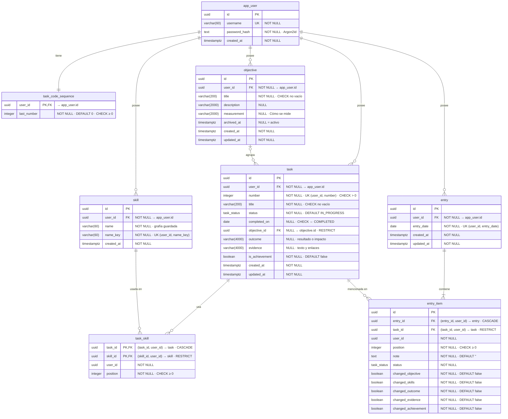

## Índice

0. [Ficha del proyecto](#0-ficha-del-proyecto)
1. [Descripción general del producto](#1-descripción-general-del-producto)
2. [Arquitectura del sistema](#2-arquitectura-del-sistema)
3. [Modelo de datos](#3-modelo-de-datos)
4. [Especificación de la API](#4-especificación-de-la-api)
5. [Historias de usuario](#5-historias-de-usuario)
6. [Tickets de trabajo](#6-tickets-de-trabajo)
7. [Pull requests](#7-pull-requests)

---

## 0. Ficha del proyecto

### **0.1. Tu nombre completo:**

### **0.2. Nombre del proyecto:**

### **0.3. Descripción breve del proyecto:**

### **0.4. URL del proyecto:**

> Puede ser pública o privada, en cuyo caso deberás compartir los accesos de manera segura. Puedes enviarlos a [alvaro@lidr.co](mailto:alvaro@lidr.co) usando algún servicio como [onetimesecret](https://onetimesecret.com/).

### 0.5. URL o archivo comprimido del repositorio

> Puedes tenerlo alojado en público o en privado, en cuyo caso deberás compartir los accesos de manera segura. Puedes enviarlos a [alvaro@lidr.co](mailto:alvaro@lidr.co) usando algún servicio como [onetimesecret](https://onetimesecret.com/). También puedes compartir por correo un archivo zip con el contenido

---

## 1. Descripción general del producto

> Describe en detalle los siguientes aspectos del producto:

### **1.1. Objetivo:**

Diario de trabajo es una aplicación web personal para registrar a diario las tareas trabajadas, su estado y su resultado, y generar a partir de ese historial el informe de la reunión semestral de evaluación de objetivos (resumen, logros destacados, fortalezas por competencia y detalle por objetivo), listo para exportar y llevar a la reunión.

Soluciona el problema de reconstruir de memoria seis meses de trabajo repartido entre tickets, correos, chats y notas sueltas justo antes de cada reunión de evaluación: con ese método, los logros de los primeros meses se olvidan o se cuentan sin su resultado ni sus evidencias, no queda un vínculo claro entre el trabajo hecho y los objetivos acordados, y las fortalezas se describen con impresiones generales en lugar de con un recuento real de en qué tareas se usó cada competencia.

Está pensado para una sola usuaria: la propietaria del diario, una profesional que registra su propio trabajo y tiene evaluaciones de objetivos cada semestre. Es una herramienta personal, no colaborativa — responsables, compañeros y equipos de RR. HH. no tienen acceso a la aplicación; el informe les llega solo como fichero exportado que la propietaria decide enviar.

### **1.2. Características y funcionalidades principales:**

**Must-have:**

- **Registro diario de entradas:** una entrada por fecha (hoy por defecto) con una o varias tareas; cada una lleva una tarea existente o nueva, una nota opcional y el estado tras ese día, y puede completarse con objetivo, competencias, resultado, evidencias y marca de logro. Guardar en una fecha que ya tiene entrada fusiona sus elementos; la misma tarea no puede repetirse en una entrada.
- **Historial cronológico:** listado de entradas por fecha descendente, agrupado por mes, con acceso directo a cada tarea desde su identificador.
- **Seguimiento y edición de tareas:** lista de tareas con ID estable (`T-001`, `T-002`…) ordenada por actividad reciente, con su línea de tiempo y edición en línea de todos sus datos.
- **Gestión de objetivos:** crear, editar, archivar y restaurar objetivos, cada uno con sus contadores de tareas, completadas y logros.
- **Informe del periodo y exportación en Markdown:** informe de los últimos 6 meses, de un semestre del año en curso o de un rango personalizado, con resumen, logros destacados, fortalezas por competencia y detalle por objetivo; vista previa, copia al portapapeles y descarga en `.md`, con exportación determinista.

**Should-have (opcionales):**

- **Exportación del informe en PDF:** la misma exportación del informe como PDF A4, con título, periodo y numeración de páginas.
- **Búsqueda y filtros de tareas:** búsqueda de texto libre y filtros por estado, objetivo, competencia y "Solo logros" en la pestaña Tareas.

Detalle completo de cada funcionalidad, requisitos y criterios de aceptación en [`docs/prd/alcance-mvp.md`](docs/prd/alcance-mvp.md) y [`docs/prd/mvp.md`](docs/prd/mvp.md).

### **1.3. Diseño y experiencia de usuario:**

> Proporciona imágenes y/o videotutorial mostrando la experiencia del usuario desde que aterriza en la aplicación, pasando por todas las funcionalidades principales.

### **1.4. Instrucciones de instalación:**

> Documenta de manera precisa las instrucciones para instalar y poner en marcha el proyecto en local (librerías, backend, frontend, servidor, base de datos, migraciones y semillas de datos, etc.)

---

## 2. Arquitectura del Sistema

### **2.1. Diagrama de arquitectura:**

La aplicación es una **SPA con API REST** en tres contenedores: `web` (React servido por nginx), `api` (NestJS) y `postgres`. El navegador ve un **único origen**: los estáticos se sirven en `/` y la API en `/api`.


En local se levanta con `docker compose`; en la nube, en Kubernetes (DOKS) con `Deployment` para `web` y `api`, `StatefulSet` + `PersistentVolumeClaim` para PostgreSQL e `Ingress` con TLS. GitHub Actions construye y publica las imágenes; el despliegue al clúster es manual.

**Patrón.** El backend sigue **Clean Architecture** (dominio → aplicación → infraestructura/interfaz), con las dependencias siempre hacia dentro: el dominio y los casos de uso son TypeScript puro y no importan `@nestjs/*` ni `@prisma/client`. La inyección de dependencias de NestJS conecta los puertos del dominio con sus adaptadores de Prisma. En el frontend no se replica la separación formal, pero la lógica que no es de interfaz vive en funciones y hooks puros.

**Por qué esta arquitectura.** El producto es pequeño (una usuaria, unos cientos de entradas al año) pero tiene reglas de integridad estrictas con test propio en el PRD: fusión de entradas en la misma fecha, protección por fecha al rellenar días pasados, recálculo de estados al eliminar, IDs de tarea secuenciales sin duplicados con peticiones simultáneas y un informe exportado idéntico byte a byte. La arquitectura se elige para que esas reglas vivan en un único sitio, se prueben sin infraestructura y se cumplan "por cualquier camino".

**Beneficios:**

- **Reglas comprobables con TDD:** el dominio se prueba con tests unitarios puros, usando los ejemplos de aceptación del PRD como casos, sin arrancar Nest ni una base de datos.
- **Integridad garantizada en el servidor:** cada caso de uso es una transacción; las reglas se refuerzan con restricciones de PostgreSQL (`UNIQUE`, `CHECK`, `ON DELETE RESTRICT`). El frontend nunca replica reglas: invalida y vuelve a leer.
- **Informe determinista:** el informe y su Markdown se generan con funciones puras del dominio, con orden total y sin depender del reloj.
- **Seguridad sencilla:** mismo origen, cookie `HttpOnly` + `SameSite=Strict`, sin CORS; el `userId` sale solo de la sesión y es parámetro obligatorio de cada repositorio (aislamiento entre usuarias).
- **Contratos compartidos:** un mismo esquema zod valida en el backend y tipa el frontend.
- **Despliegue reproducible:** las mismas imágenes en `docker compose` (revisor externo) y en Kubernetes.

**Sacrificios y déficits:**

- **Más código de lo estrictamente necesario:** cada caso de uso tiene su puerto además de la implementación con Prisma; para un MVP de este tamaño, llamar a Prisma desde los servicios sería más corto.
- **Disciplina de capas:** hay que mantener los límites de importación (se refuerzan con ESLint) o la arquitectura se degrada.
- **Dos runners de test:** Jest en el backend (idiomático en Nest) y Vitest en el frontend.
- **PostgreSQL dentro del clúster:** decisión consciente para practicar `StatefulSet`; sin copias de seguridad, se mitiga con un _seed_ idempotente y datos ficticios.
- **"Hoy" lo pone el navegador:** el cliente envía su fecha local (`X-Client-Date`) y el servidor solo la acepta a ±1 día de su fecha UTC; es una pequeña complejidad añadida para respetar la zona horaria de la usuaria.
- **Sin escalado horizontal ni observabilidad completa:** desproporcionados para una sola usuaria; se dejan fuera de forma explícita.

Detalle completo (diagramas de contexto, capas, secuencia, datos, despliegue y CI) en [`docs/arquitectura.md`](docs/arquitectura.md); decisiones de stack y prácticas en [`docs/adr/0001-stack-tecnologico.md`](docs/adr/0001-stack-tecnologico.md) y [`docs/adr/0002-practicas-de-ingenieria.md`](docs/adr/0002-practicas-de-ingenieria.md).

### **2.2. Descripción de componentes principales:**

| Componente                                 | Tecnología                                                   | Responsabilidad                                                                                                                                                                                                          |
| ------------------------------------------ | ------------------------------------------------------------ | ------------------------------------------------------------------------------------------------------------------------------------------------------------------------------------------------------------------------ |
| **Frontend (`apps/web`)**                  | React + Vite, TanStack Query, TypeScript; servido por nginx  | Las cuatro pestañas (Diario, Tareas, Objetivos, Informe), cabecera con resumen en vivo, mensajes y confirmaciones en la página, tema claro/oscuro y diseño adaptado a pantallas estrechas. Genera el PDF en el navegador |
| **API REST (`apps/api`)**                  | NestJS sobre Node.js, TypeScript                             | Expone `/api` (entradas, tareas, objetivos, competencias, resumen, informe, autenticación) y traduce HTTP a casos de uso                                                                                                 |
| ↳ Capa de dominio                          | TypeScript puro                                              | Entidades (`Entry`, `Task`, `Objective`…), `CalendarDate` y las reglas: `EntryMerger` (fusión), `TaskStateProjector` (protección por fecha y recálculo), `SkillNormalizer`, `ReportBuilder` y `MarkdownRenderer`         |
| ↳ Capa de aplicación                       | TypeScript puro                                              | Un caso de uso por operación (`SaveDailyEntry`, `DeleteEntry`, `UpdateTask`, `GeneratePeriodReport`…), cada uno en una transacción a través del puerto `UnitOfWork`                                                      |
| ↳ Capa de infraestructura                  | Prisma, `express-session` + `connect-pg-simple`, Argon2      | Repositorios sobre PostgreSQL, secuencia atómica de ID de tarea por usuaria, almacén de sesiones y hash de contraseñas                                                                                                   |
| ↳ Capa de interfaz                         | Controllers, guards y pipes de NestJS, `@nestjs/throttler`   | `SessionGuard` (`401` sin sesión, caducidad a los 30 min), validación con zod, límite de intentos de login y traducción de errores de dominio a HTTP                                                                     |
| **Paquete compartido (`packages/shared`)** | TypeScript, zod                                              | Esquemas y tipos de los DTO, enumeraciones y utilidades de fechas de calendario (`CalendarDate`, cálculo del periodo) usados por los dos lados                                                                           |
| **Base de datos**                          | PostgreSQL                                                   | Datos del diario y sesiones; restricciones de unicidad, `CHECK` y `RESTRICT` como red de seguridad de las reglas; _seed_ idempotente con dos usuarias de prueba                                                          |
| **Contenedores y orquestación**            | Docker, `docker compose`, Kubernetes (DOKS), ingress-nginx   | Entorno local reproducible para el revisor y despliegue en la nube (`Deployment`, `StatefulSet` + `PVC`, `Ingress`, `Job` de migraciones y _seed_)                                                                       |
| **CI**                                     | GitHub Actions, GHCR                                         | Lint, tests (Jest, Vitest, Playwright), `pnpm audit`, construcción y publicación de las imágenes de `api` y `web`                                                                                                        |
| **Tests**                                  | Jest + supertest, Vitest + React Testing Library, Playwright | Unitarios de dominio, integración contra PostgreSQL real, contrato HTTP, componentes y E2E del flujo principal                                                                                                           |

### **2.3. Descripción de alto nivel del proyecto y estructura de ficheros**

> Representa la estructura del proyecto y explica brevemente el propósito de las carpetas principales, así como si obedece a algún patrón o arquitectura específica.

### **2.4. Infraestructura y despliegue**

> Detalla la infraestructura del proyecto, incluyendo un diagrama en el formato que creas conveniente, y explica el proceso de despliegue que se sigue

### **2.5. Seguridad**

> Enumera y describe las prácticas de seguridad principales que se han implementado en el proyecto, añadiendo ejemplos si procede

### **2.6. Tests**

> Describe brevemente algunos de los tests realizados

---

## 3. Modelo de Datos

### **3.1. Diagrama del modelo de datos:**

PostgreSQL, gestionado con Prisma. Todas las tablas del diario llevan `user_id` (aislamiento por usuaria, RF-3); las tablas de relación usan claves foráneas compuestas `(x_id, user_id)` para que la base rechace mezclar registros de dos usuarias. Las fechas de calendario son `date`, sin hora (RNF-4).



Además existe la tabla `session` de `connect-pg-simple` (`sid` PK, `sess json`, `expire timestamp`), sin relaciones con las demás.

### **3.2. Descripción de entidades principales:**

| Tabla                | Qué representa                                                                                                       | Restricciones clave                                                                                                                                                      |
| -------------------- | -------------------------------------------------------------------------------------------------------------------- | ------------------------------------------------------------------------------------------------------------------------------------------------------------------------ |
| `app_user`           | Cuenta de usuaria; solo las dos del _seed_, sin registro                                                             | `username` único; contraseña solo como hash Argon2id                                                                                                                     |
| `task_code_sequence` | Último número de tarea asignado a cada usuaria                                                                       | Se incrementa con `UPDATE … RETURNING` en la misma transacción que crea la tarea; nunca baja, así que los ID borrados no se reutilizan (RF-15)                           |
| `objective`          | Meta del periodo de evaluación: título, descripción y "Cómo se mide"                                                 | Título obligatorio, no único; `archived_at` marca el archivado sin perder las tareas (RF-28); no se borra si tiene tareas (`RESTRICT`, RF-30)                            |
| `task`               | Trabajo seguido en el tiempo; su ID visible `T-003` se forma a partir de `number`                                    | `UNIQUE (user_id, number)` (RF-15); `CHECK` estado `COMPLETED` ⇔ `completed_on` no nulo (RF-24); no se borra si alguna entrada la menciona (`RESTRICT`, RF-25)           |
| `skill`              | Competencia de la usuaria, con su grafía y una clave normalizada (recortada y en minúsculas)                         | `UNIQUE (user_id, name_key)`: "kubernetes" reutiliza "Kubernetes" (RF-13); se borra cuando ninguna tarea la usa                                                          |
| `task_skill`         | Competencias que usa cada tarea, en el orden en que se introdujeron                                                  | Clave primaria `(task_id, skill_id)`: sin duplicados en una tarea                                                                                                        |
| `entry`              | El diario de un día concreto                                                                                         | `UNIQUE (user_id, entry_date)`: una entrada por fecha; guardar en una fecha existente fusiona (RF-10)                                                                    |
| `entry_item`         | Una tarea dentro de una entrada: nota, estado tras ese día y qué datos de la tarea cambió ese guardado (`changed_*`) | `UNIQUE (entry_id, task_id)` (RF-11); las marcas `changed_*` implementan la protección por fecha de RF-12: un dato solo se aplica si ninguna entrada posterior lo cambió |

Lo derivable no se guarda: la última actividad y el número de entradas de cada tarea, los contadores de objetivo, el resumen de la cabecera y el informe se calculan en cada consulta (RNF-3: 300 entradas, 600 tareas).

Detalle completo (columnas, tipos, `schema.prisma`, `CHECK` complementarios, consultas que sostienen cada regla, índices, _seed_ y decisiones DM-1 a DM-8) en [`docs/modelo-de-datos.md`](docs/modelo-de-datos.md).

---

## 4. Especificación de la API

API REST en JSON bajo `/api`, en el mismo origen que la SPA. La especificación completa (21 operaciones: autenticación, resumen, entradas, tareas, objetivos, competencias, informe y _health_) está en [`docs/api/openapi.yaml`](docs/api/openapi.yaml) (OpenAPI 3.1). Es la fuente de verdad del contrato: los esquemas zod de `packages/shared` la implementan y los tests de contrato la comprueban.

Convenciones comunes:

- **Sesión**: cookie `sid` (`HttpOnly`, `SameSite=Strict`) que crea `POST /auth/login` y caduca a los 30 min de inactividad. Todo exige sesión salvo `login` y `health` (`401`). La usuaria sale solo de la sesión; un recurso de otra usuaria responde `404`, igual que uno inexistente (RF-3).
- **Fechas** como `AAAA-MM-DD`, sin hora. **Identificadores públicos**: la fecha para la entrada, el código `T-003` para la tarea y el UUID para el objetivo.
- **`X-Client-Date`**: la SPA envía su fecha local ("hoy", RNF-4) en cada escritura; el servidor la acepta a ±1 día de su fecha UTC.
- **Errores**: `{ "code", "message", "details"? }` con un código estable (`VALIDATION_FAILED`, `NOT_FOUND`, `TASK_HAS_ENTRIES`, `ENTRY_DATE_IN_FUTURE`…). Cada escritura es una transacción: se aplica entera o nada (RNF-5).

Los tres endpoints principales, que concentran las reglas centrales del producto (extracto de `docs/api/openapi.yaml`; los esquemas referenciados están definidos allí):

```yaml
paths:
  /entries/{date}:
    put:
      operationId: saveDailyEntry
      summary: Save the entry of a date (create or merge)
      description: >
        Creates the entry of `date` or merges the items into the existing one (RF-10).
        `date` must not be after X-Client-Date (RF-7). The submitted items must not repeat
        a task (RF-11). Status and each detail field present in an item are applied to the
        task only if no later-dated entry mentions the task / changed that field (RF-12);
        absent detail fields are left untouched.
      parameters:
        - {
            name: date,
            in: path,
            required: true,
            schema: { $ref: "#/components/schemas/CalendarDate" },
          }
        - {
            name: X-Client-Date,
            in: header,
            required: true,
            schema: { $ref: "#/components/schemas/CalendarDate" },
          }
      requestBody:
        required: true
        content:
          application/json:
            schema: { $ref: "#/components/schemas/SaveEntryRequest" }
      responses:
        "200":
          {
            description: Saved (possibly merged) entry,
            content:
              {
                application/json:
                  { schema: { $ref: "#/components/schemas/Entry" } },
              },
          }
        "400": { description: VALIDATION_FAILED or CLIENT_DATE_INVALID }
        "401": { description: UNAUTHENTICATED }
        "404": { description: Referenced task or objective not found }
        "422": { description: ENTRY_DATE_IN_FUTURE or DUPLICATE_TASK_IN_ENTRY }

  /tasks/{code}:
    patch:
      operationId: updateTask
      summary: Edit a task inline
      description: >
        Partial update (RF-22). To COMPLETED, completedOn = last activity date, or
        X-Client-Date if the task has no entries; leaving COMPLETED clears it (RF-23, RF-24).
        Creates no entry item and never triggers the RF-12 protection.
      parameters:
        - {
            name: code,
            in: path,
            required: true,
            schema: { $ref: "#/components/schemas/TaskCode" },
          }
        - {
            name: X-Client-Date,
            in: header,
            required: true,
            schema: { $ref: "#/components/schemas/CalendarDate" },
          }
      requestBody:
        required: true
        content:
          application/json:
            schema: { $ref: "#/components/schemas/UpdateTaskRequest" }
      responses:
        "200":
          {
            description: Updated task,
            content:
              {
                application/json:
                  { schema: { $ref: "#/components/schemas/Task" } },
              },
          }
        "400": { description: VALIDATION_FAILED or CLIENT_DATE_INVALID }
        "401": { description: UNAUTHENTICATED }
        "404": { description: Task or objective not found }

  /reports:
    get:
      operationId: generatePeriodReport
      summary: Period report and its Markdown
      description: >
        Report of the inclusive range [from, to] (RF-33…RF-36) with every list in its final
        order, plus the Markdown export, byte-identical for the same data and period (RF-39).
      parameters:
        - {
            name: from,
            in: query,
            required: true,
            schema: { $ref: "#/components/schemas/CalendarDate" },
          }
        - {
            name: to,
            in: query,
            required: true,
            schema: { $ref: "#/components/schemas/CalendarDate" },
          }
      responses:
        "200":
          {
            description: Report,
            content:
              {
                application/json:
                  { schema: { $ref: "#/components/schemas/Report" } },
              },
          }
        "400": { description: Missing or invalid dates, or from > to }
        "401": { description: UNAUTHENTICATED }
```

**Ejemplo 1 — guardar la entrada del 2026-11-19** con una tarea existente que se completa como logro y una tarea nueva con un objetivo nuevo:

```http
PUT /api/entries/2026-11-19
Content-Type: application/json
X-Client-Date: 2026-11-23
Cookie: sid=…

{
  "items": [
    {
      "task": { "code": "T-004" },
      "note": "Postmortem redactado y compartido con el equipo.",
      "status": "COMPLETED",
      "isAchievement": true,
      "outcome": "Reducción del 25% de las conexiones simultáneas en las instancias tomcat TOMCAT-1",
      "evidence": "https://wiki.interna/postmortems/TOMCAT-1"
    },
    {
      "task": { "title": "Revisar la política de copias de seguridad" },
      "status": "IN_PROGRESS",
      "objective": { "title": "Fiabilidad de la plataforma" },
      "skills": ["kubernetes", "Copias de seguridad"]
    }
  ]
}
```

```http
HTTP/1.1 200 OK
Content-Type: application/json

{
  "date": "2026-11-19",
  "items": [
    {
      "task": {
        "code": "T-004", "title": "Incidente instancia tomcat TOMCAT-1",
        "status": "COMPLETED", "isAchievement": true,
        "objective": { "id": "3f1c2a9e-5b7d-4c1e-9a2f-8d6e4b0c7a11", "title": "Mantenimiento del servicio de portales del proyecto PROYECTO-1", "archived": false },
        "skills": ["Resolución de incidencias"]
      },
      "note": "Postmortem redactado y compartido con el equipo.",
      "status": "COMPLETED"
    },
    {
      "task": {
        "code": "T-010", "title": "Revisar la política de copias de seguridad",
        "status": "IN_PROGRESS", "isAchievement": false,
        "objective": { "id": "9b0e7d3c-2a41-4f6e-8c5d-1e2f3a4b5c6d", "title": "Fiabilidad de la plataforma", "archived": false },
        "skills": ["Kubernetes", "Copias de seguridad"]
      },
      "note": "",
      "status": "IN_PROGRESS"
    }
  ]
}
```

La tarea nueva recibe el siguiente código de la usuaria (`T-010`, RF-15) y `"kubernetes"` se guarda con la grafía ya existente, `"Kubernetes"` (RF-13). Si la fecha ya tenía entrada, los elementos se fusionan en ella (RF-10).

**Ejemplo 2 — completar una tarea desde Tareas:**

```http
PATCH /api/tasks/T-008
Content-Type: application/json
X-Client-Date: 2026-11-23

{ "status": "COMPLETED" }
```

```http
HTTP/1.1 200 OK

{ "code": "T-008", "title": "Desarrollo de evolutivo EVOLUTIVO-1", "status": "COMPLETED",
  "completedOn": "2026-10-27", "isAchievement": false, "objective": { "id": "…", "title": "Desarrollo evolutivo del proyecto PROYECTO-1", "archived": false },
  "skills": ["Diseño y planificación"], "outcome": null, "evidence": null,
  "lastActivityOn": "2026-10-27", "entryCount": 1 }
```

`completedOn` toma la fecha de la última actividad (2026-10-27), no la de hoy; solo si la tarea no tuviera entradas sería `X-Client-Date` (RF-23).

**Ejemplo 3 — informe del periodo** (datos del [informe de referencia](docs/modelo/informe.md); listas recortadas):

```http
GET /api/reports?from=2026-10-01&to=2026-11-21
```

```http
HTTP/1.1 200 OK

{
  "period": { "from": "2026-10-01", "to": "2026-11-21" },
  "summary": { "entries": 8, "tasksWorked": 5, "tasksCompleted": 4, "achievements": 1 },
  "achievements": [
    { "code": "T-004", "title": "Incidente instancia tomcat TOMCAT-1",
      "objective": { "id": "3f1c2a9e-…", "title": "Mantenimiento del servicio de portales del proyecto PROYECTO-1", "archived": false },
      "completedOn": "2026-11-19", "interval": { "from": "2026-11-16", "to": "2026-11-19" }, "entryCount": 2,
      "outcome": "Reducción del 25% de las conexiones simultáneas en las instancias tomcat TOMCAT-1",
      "skills": ["Resolución de incidencias"], "evidence": "https://wiki.interna/postmortems/TOMCAT-1" }
  ],
  "strengths": [
    { "skill": "Diseño y planificación", "taskCount": 3, "entryCount": 5, "taskCodes": ["T-005", "T-008", "T-009"] }
  ],
  "byObjective": [
    { "objective": { "id": "…", "title": "Configuración arnés IA equipo PROYECTO-1", "measurement": "Incremento del número de tareas resueltas…", "archived": false },
      "tasks": [ { "code": "T-001", "title": "Onboarding proyecto PROYECTO-1", "status": "COMPLETED", "isAchievement": false,
                   "interval": { "from": "2026-10-19", "to": "2026-10-22" }, "entryCount": 2, "outcome": null } ] }
  ],
  "markdown": "# Informe de tareas, logros y fortalezas\n\nPeriodo: 2026-10-01 a 2026-11-21\n\n## Resumen\n…"
}
```

El cliente pinta las secciones a partir del modelo, genera el PDF desde él (RF-40) y descarga `markdown` tal cual como `informe-diario-2026-10-01_2026-11-21.md` (RF-38).

---

## 5. Historias de Usuario

**Historia de Usuario 1 — [E2-1 · Registrar el trabajo del día desde un solo formulario](docs/backlog/E2-registro-diario/us-registrar-entrada-del-dia.md)**

Como propietaria del diario, quiero anotar al final de la jornada las tareas que he trabajado, con una nota y el estado en que quedan, creando sobre la marcha la tarea o el objetivo que me falte, para registrar el día mientras lo tengo fresco sin salir de la pestaña Diario.

Criterios clave: los únicos datos obligatorios son la fecha y, por elemento, la tarea; se puede crear tarea y objetivo nuevos sin salir del formulario; 0 cambios de pestaña en un test E2E (P-5); al guardar, cada tarea nueva recibe el siguiente ID secuencial sin duplicados aunque haya peticiones simultáneas.

**Historia de Usuario 2 — [E6-2 · Ver los logros que cerré en el periodo](docs/backlog/E6-informe-del-periodo/us-logros-destacados.md)**

Como propietaria del diario, quiero que el informe liste los logros que completé en el periodo con su resultado, su objetivo, sus competencias y sus evidencias, para llevar a la reunión también los logros de los primeros meses, contados con lo que conseguí.

Criterios clave: entra toda tarea con marca de logro cuya fecha de finalización cae dentro del periodo, la mencione o no una entrada del rango; cada tarjeta muestra resultado, competencias y evidencias (o un aviso si falta el resultado); el orden es por fecha de finalización descendente, con ID de tarea ascendente como desempate.

**Historia de Usuario 3 — [E6-5 · Llevarme el informe en Markdown](docs/backlog/E6-informe-del-periodo/us-exportar-markdown.md)**

Como propietaria del diario, quiero revisar el informe completo en Markdown, copiarlo o descargarlo como fichero, y obtener siempre el mismo texto con los mismos datos, para llevarlo a la reunión de evaluación sin rehacerlo a mano.

Criterios clave: vista previa, copia al portapapeles (con alternativa manual si el navegador la rechaza) y descarga `informe-diario-<desde>_<hasta>.md`; la exportación es determinista byte a byte con los mismos datos; un test E2E recorre el flujo principal completo, de crear un objetivo a descargar el informe con la tarea cerrada como logro.

Las 23 historias del MVP, todas con sus criterios de aceptación completos, están en [`docs/backlog/`](docs/backlog/backlog-mvp.md).

---

## 6. Tickets de Trabajo

> Documenta 3 de los tickets de trabajo principales del desarrollo, uno de backend, uno de frontend, y uno de bases de datos. Da todo el detalle requerido para desarrollar la tarea de inicio a fin teniendo en cuenta las buenas prácticas al respecto.

**Ticket 1**

**Ticket 2**

**Ticket 3**

---

## 7. Pull Requests

> Documenta 3 de las Pull Requests realizadas durante la ejecución del proyecto

**Pull Request 1**

**Pull Request 2**

**Pull Request 3**
