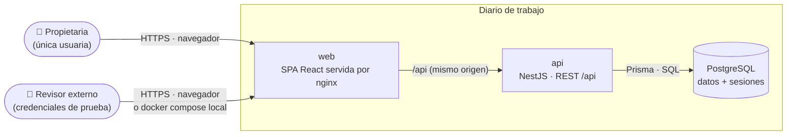
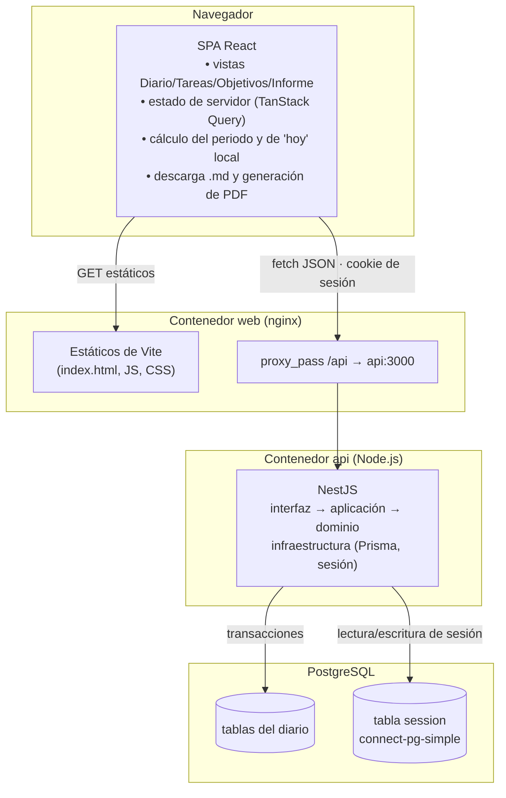
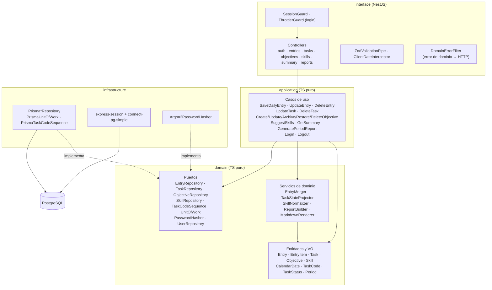
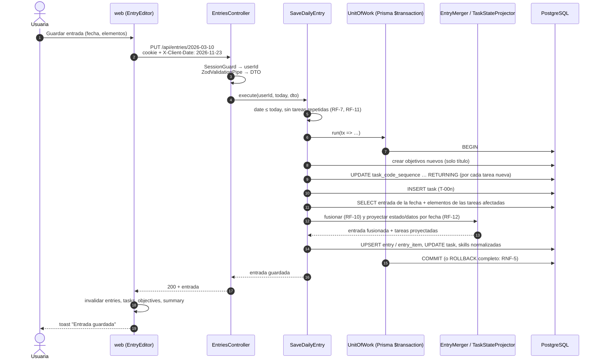
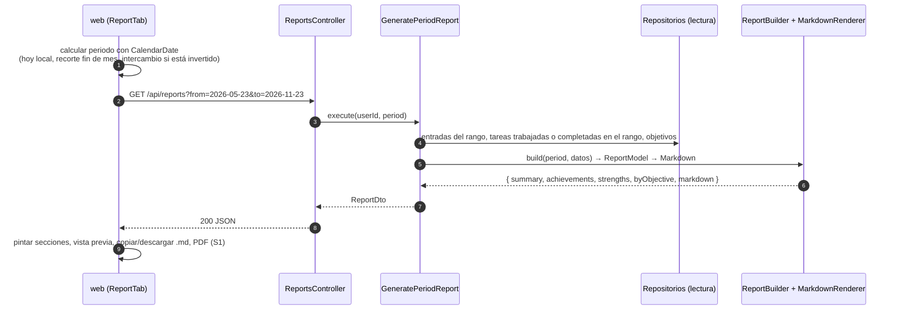
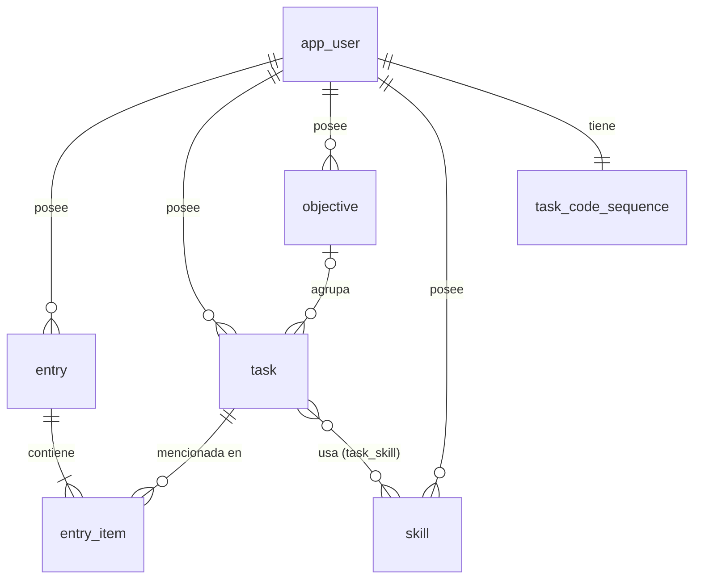
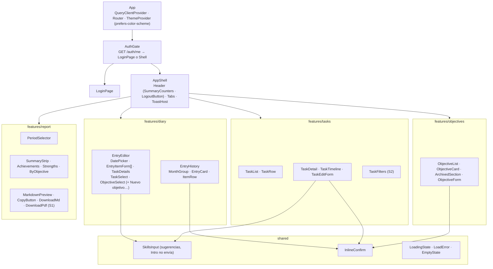
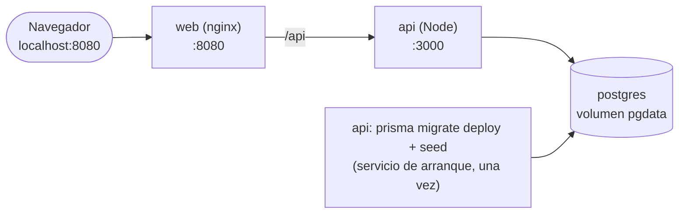
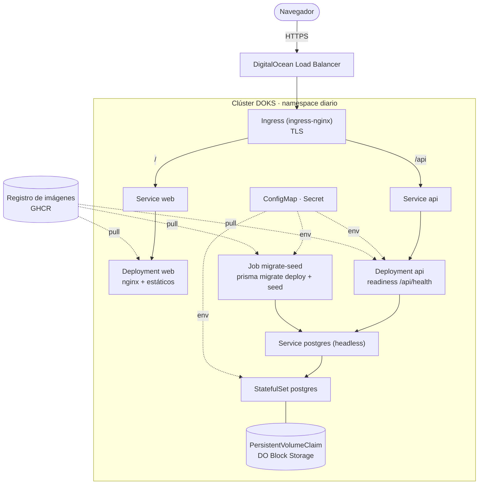
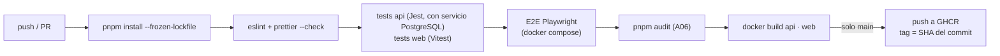

# Arquitectura del Diario de trabajo (MVP)

> **Estado:** Aceptada · **Fecha:** 2026-11-23
> **Base:** [PRD del MVP](./prd/mvp.md), [ADR-0001 — Stack tecnológico](./adr/0001-stack-tecnologico.md), [ADR-0002 — Prácticas de ingeniería](./adr/0002-practicas-de-ingenieria.md), [modelo de dominio](./modelo/dominio.md), [interfaz](./modelo/interfaz.md) e [informe de referencia](./modelo/informe.md).
> **Qué hay aquí:** la arquitectura del sistema, sus componentes principales, cómo se reparten las reglas del PRD entre ellos y cómo se despliega. El stack ya está decidido en ADR-0001 y no se vuelve a discutir; lo que este documento añade y no está en los ADR se recoge en la sección 11 (decisiones D-1 a D-8, revisadas y aprobadas).
> **Qué no hay aquí:** el modelo de datos detallado (columnas, tipos, migraciones), que está en [modelo-de-datos.md](./modelo-de-datos.md), ni la especificación completa de la API (cuerpos, códigos de error por endpoint). Aquí solo aparecen al nivel necesario para entender los componentes.

---

## 1. Resumen

El Diario de trabajo es una aplicación web de **una sola usuaria** con tres piezas desplegables:

1. **`web`** — SPA en React + Vite, servida como estáticos por nginx, que además hace de _proxy_ inverso de `/api` hacia el backend. Navegador y API comparten origen.
2. **`api`** — API REST en NestJS organizada en **Clean Architecture** (dominio → aplicación → infraestructura/interfaz). Toda la lógica de las reglas del PRD (fusión, protección por fecha, recálculo, ID atómico, informe determinista) vive en el dominio y en los casos de uso, sin depender de Nest ni de Prisma.
3. **`postgres`** — PostgreSQL, que guarda tanto los datos del diario como las sesiones (`connect-pg-simple`).

Además hay un paquete compartido **`packages/shared`** con los contratos (esquemas y tipos de los DTO) y las utilidades de fechas de calendario que usan los dos lados.

Los principios que guían el diseño, por orden de importancia:

| Principio                                | De dónde viene                   | Consecuencia arquitectónica                                                                                                           |
| ---------------------------------------- | -------------------------------- | ------------------------------------------------------------------------------------------------------------------------------------- |
| Integridad de datos por cualquier camino | RNF-6, RNF-5, RF-10…RF-15, RF-24 | Las reglas viven en el **dominio del backend** y cada caso de uso es **una transacción**; el frontend nunca es la fuente de la verdad |
| Informe verificable byte a byte          | RF-39, P-2                       | El informe y su Markdown se generan con **funciones puras** del dominio, con orden total fijado y sin reloj ni aleatoriedad           |
| Privacidad y aislamiento                 | RF-2, RF-3, RNF-7, OWASP A01     | `userId` sale **solo de la sesión** y es parámetro obligatorio de cada puerto de repositorio                                          |
| Fechas de calendario sin hora            | RNF-4                            | Un _value object_ `CalendarDate` (`AAAA-MM-DD`) en todo el sistema; columnas `date` en PostgreSQL; nunca `Date` de JavaScript         |
| Testeable sin infraestructura            | ADR-0002, TDD                    | Dominio y casos de uso se prueban con dobles en memoria de los puertos                                                                |
| Simplicidad proporcionada a una usuaria  | RNF-3 (300 entradas, 600 tareas) | Sin colas, cachés ni servicios extra; el informe se calcula en memoria por petición                                                   |

---

## 2. Vista de contexto



No hay sistemas externos: ni proveedores de identidad, ni integraciones, ni telemetría de terceros (alcance §4.2, RNF-7). Las evidencias de una tarea son texto y enlaces que solo pinta el navegador; el servidor nunca los visita (OWASP A10).

---

## 3. Vista de contenedores



| Contenedor | Tecnología                        | Responsabilidad                                                                                            | Estado     |
| ---------- | --------------------------------- | ---------------------------------------------------------------------------------------------------------- | ---------- |
| `web`      | React + Vite, servido por nginx   | Presentación, interacción, estado de servidor en caché, cálculo del periodo, portapapeles, descargas y PDF | Sin estado |
| `api`      | NestJS sobre Node.js (TypeScript) | Autenticación, autorización, reglas de dominio, transacciones, generación del informe y su Markdown        | Sin estado |
| `postgres` | PostgreSQL                        | Persistencia del diario, secuencias de ID por usuaria y sesiones                                           | Con estado |

Que nginx sirva la SPA y haga de _proxy_ de `/api` da **un único origen**: la cookie de sesión puede ser `SameSite=Strict`, no hace falta habilitar CORS (A05) y el mismo esquema funciona en `docker compose` y en Kubernetes.

---

## 4. Estructura del monorepo

```text
/
├── apps/
│   ├── api/                      # NestJS (Jest + supertest)
│   │   ├── src/
│   │   │   ├── domain/           # entidades, value objects, reglas, puertos, errores
│   │   │   ├── application/      # casos de uso (uno por operación)
│   │   │   ├── infrastructure/   # Prisma, repositorios, sesión, hashing, reloj
│   │   │   ├── interface/        # controllers, guards, pipes, filtros de error
│   │   │   └── main.ts
│   │   ├── prisma/               # schema.prisma, migraciones, seed idempotente
│   │   └── test/                 # tests de integración/contrato (supertest + PostgreSQL real)
│   └── web/                      # React + Vite (Vitest + Testing Library)
│       ├── src/
│       │   ├── app/              # shell, rutas, proveedores, cabecera, sesión
│       │   ├── features/         # diary/, tasks/, objectives/, report/
│       │   ├── shared/           # componentes comunes (toasts, confirmación en línea, carga)
│       │   └── api/              # cliente HTTP y hooks de TanStack Query
│       └── nginx.conf
├── packages/
│   └── shared/                   # esquemas zod de los DTO, tipos, CalendarDate y utilidades de periodo
├── e2e/                          # Playwright (flujo principal y RNF de interfaz)
├── deploy/
│   ├── compose/                  # docker-compose.yml (local y revisor)
│   └── k8s/                      # manifiestos para DOKS
└── .github/workflows/            # CI: lint, tests, audit, build y push de imágenes
```

Una regla de ESLint de límites de importación (p. ej. `eslint-plugin-boundaries` o `no-restricted-imports`) impide que `domain/` y `application/` importen `@nestjs/*`, `@prisma/client` o cualquier carpeta exterior, como pide ADR-0002.

---

## 5. Backend (`apps/api`)

### 5.1 Capas y dependencias



- **domain**: entidades, _value objects_, servicios de dominio y puertos. No conoce HTTP, SQL ni Nest.
- **application**: un caso de uso por operación del producto. Recibe siempre un `userId` y, cuando la regla depende de "hoy", una `CalendarDate` explícita. Abre la transacción a través del puerto `UnitOfWork`.
- **infrastructure**: adaptadores de Prisma que implementan los puertos; es la única capa que conoce el esquema de base de datos.
- **interface**: controladores finos que validan la entrada, extraen `userId` de la sesión, llaman al caso de uso y traducen el resultado o el error de dominio a HTTP.
- **Cableado**: cada módulo Nest declara `{ provide: TASK_REPOSITORY, useClass: PrismaTaskRepository }` y construye los casos de uso con `useFactory`, de modo que los casos de uso no llevan decoradores de Nest.

### 5.2 Módulos

| Módulo Nest                  | Casos de uso                                                                                                      | Requisitos                      |
| ---------------------------- | ----------------------------------------------------------------------------------------------------------------- | ------------------------------- |
| `AuthModule`                 | `Login`, `Logout`, `GetCurrentUser`                                                                               | RF-1, RF-2, OWASP A02/A07       |
| `EntriesModule`              | `ListEntries`, `SaveDailyEntry`, `UpdateEntry`, `DeleteEntry`                                                     | RF-7…RF-12, RF-14, RF-16, RF-18 |
| `TasksModule`                | `ListTasks`, `GetTaskTimeline`, `UpdateTask`, `DeleteTask`, (`SearchTasks` S2)                                    | RF-15, RF-20…RF-26              |
| `ObjectivesModule`           | `ListObjectives`, `CreateObjective`, `UpdateObjective`, `ArchiveObjective`, `RestoreObjective`, `DeleteObjective` | RF-27…RF-31                     |
| `SkillsModule`               | `SuggestSkills` (y la normalización que usan entradas y tareas)                                                   | RF-13                           |
| `SummaryModule`              | `GetSummary`                                                                                                      | RF-4                            |
| `ReportsModule`              | `GeneratePeriodReport`                                                                                            | RF-32…RF-39                     |
| `PersistenceModule` (global) | `PrismaService`, `PrismaUnitOfWork`, repositorios                                                                 | —                               |

### 5.3 Componentes clave del dominio

**`CalendarDate`** — _value object_ inmutable sobre una cadena `AAAA-MM-DD`, con comparación, `addMonths` con recorte al último día del mes (RF-32) y validación. Nunca se construye a partir de un `Date` con hora. Vive en `packages/shared` porque el frontend lo usa para calcular el periodo y "hoy".

**`TaskCode` y `TaskCodeSequence`** (RF-15) — `TaskCode` formatea `T-001`, `T-002`… (con tres cifras mínimo, sin límite superior). El puerto `TaskCodeSequence.next(userId)` devuelve el siguiente número. Su adaptador mantiene una fila por usuaria en `task_code_sequence(user_id, last_number)` y la incrementa dentro de la misma transacción que crea la tarea:

```sql
UPDATE task_code_sequence SET last_number = last_number + 1
WHERE user_id = $1 RETURNING last_number;
```

El bloqueo de fila serializa dos creaciones simultáneas; como el contador nunca baja, un ID eliminado no se reutiliza. Además, la restricción `UNIQUE (user_id, number)` en `task` garantiza que nunca se guarden dos tareas con el mismo ID aunque fallara la lógica; si salta, el caso de uso reintenta la transacción un número acotado de veces (RNF-5).

**`EntryMerger`** (RF-10, RF-11) — función pura que recibe la entrada existente de la fecha (o ninguna) y los elementos del formulario, rechaza tareas repetidas en el formulario (`DuplicateTaskInEntryError`) y devuelve la entrada fusionada: concatena notas con una línea en blanco (o deja la no vacía), toma el estado nuevo y conserva el orden de guardado.

**`TaskStateProjector`** (RF-12, RF-14, RF-23, RF-24) — el corazón de las reglas de integridad. En lugar de aplicar cambios "por orden de guardado", **proyecta** el estado de la tarea a partir de su historial de elementos ordenado por fecha de entrada:

- Cada `EntryItem` guarda el estado elegido y, para los datos de detalle (objetivo, competencias, resultado, evidencias, logro), el valor del elemento y si ese guardado **lo cambió** (`changedFields`), calculado al guardar comparándolo con el valor que tenía la tarea (RF-12, «un dato cuenta como cambiado si difería»).
- **Estado y fecha de finalización**: los fija el elemento de la entrada más reciente que menciona la tarea; si es `Completada`, la fecha de finalización es la de esa entrada; si no, se borra. Si no queda ningún elemento, se conservan los valores actuales (RF-14).
- **Cada dato de detalle**: el valor de un elemento se aplica solo si ninguna entrada con fecha posterior tiene ese dato en `changedFields`.
- **Cambios desde Tareas** (RF-23): no crean elementos; el caso de uso `UpdateTask` fija la fecha de finalización a la última actividad o a "hoy" y el proyector no se vuelve a ejecutar sobre ese cambio hasta la siguiente operación del Diario.
- Invariante comprobada en la entidad `Task`: `completedOn !== null ⇔ status === 'Completada'` (RF-24). Cualquier camino que la incumpla lanza un error de dominio antes de persistir.

**`SkillNormalizer`** (RF-13) — compara sin distinguir mayúsculas (y recortando espacios), reutiliza la grafía ya existente de la usuaria y elimina duplicados dentro de la misma tarea. Las sugerencias son una consulta por prefijo/subcadena sobre las competencias de la usuaria.

**`ReportBuilder` y `MarkdownRenderer`** (RF-33…RF-39) — funciones puras:

- `ReportBuilder(period, entries, tasks, objectives)` → `ReportModel` con las cuatro secciones, aplicando literalmente la semántica del PRD (trabajada = mencionada por una entrada del rango; completada/logro = fecha de finalización en el rango; intervalos y recuentos solo con entradas del rango; un solo día se muestra como una fecha) y **todos los desempates** de RF-34, RF-35 y RF-36, de modo que el orden es total.
- `MarkdownRenderer(model)` → `string` con el formato exacto de `docs/modelo/informe.md`: sin fecha de generación, saltos de línea `\n`, ordenación con comparación de cadenas por código de unidad (no `localeCompare`, que depende del entorno) salvo donde se defina otra cosa, y sin ninguna fuente de no determinismo (RF-39).

### 5.4 Flujo: guardar la entrada del día



Eliminar una entrada o quitar un elemento (`DeleteEntry`, `UpdateEntry`) sigue el mismo patrón: transacción, recálculo con `TaskStateProjector` sobre los elementos que quedan, persistencia y, en el cliente, invalidación de consultas.

### 5.5 Flujo: generar el informe



La validación de "Personalizado" con fechas vacías (RF-32) es de interfaz: si falta alguna fecha, el cliente no llama a la API y muestra el mensaje propio. La API, por su parte, rechaza con `400` una petición sin `from` o `to`.

### 5.6 "Hoy" y la zona horaria del navegador

El PRD fija que "hoy" es la **fecha local del navegador** (RNF-4, supuesto 4.3.3), pero hay dos reglas de servidor que dependen de ella: no guardar entradas con fecha futura (RF-7) y fijar "hoy" como fecha de finalización al completar desde Tareas una tarea sin entradas (RF-23).

- El cliente envía su fecha local en la cabecera `X-Client-Date: AAAA-MM-DD` en cada petición de escritura (la añade el cliente HTTP de forma centralizada).
- Un interceptor la valida y la convierte en `CalendarDate`. Para que no pueda usarse para saltarse la regla, el servidor la acepta solo si está a ±1 día de su fecha UTC (cubre cualquier zona horaria real); fuera de ese margen responde `400`.
- Los casos de uso reciben `today` como parámetro y nunca leen el reloj, lo que los hace deterministas y fáciles de probar.

### 5.7 Autenticación, sesión y autorización

| Aspecto                 | Diseño                                                                                                                                                                                                                   |
| ----------------------- | ------------------------------------------------------------------------------------------------------------------------------------------------------------------------------------------------------------------------ |
| Cuentas                 | Solo las del _seed_ (dos usuarias de prueba, R-6). Contraseñas con hash Argon2id (A02). Sin registro ni recuperación                                                                                                     |
| Login                   | `POST /api/auth/login`; mensaje de error genérico que no revela si el usuario existe (RF-1); `session.regenerate()` tras autenticar (A07); límite de intentos con `@nestjs/throttler`                                    |
| Sesión                  | `express-session` + `connect-pg-simple`; cookie `HttpOnly`, `SameSite=Strict`, `Secure` en producción; `rolling: true` con `maxAge` de 30 min, de modo que cada petición reinicia la inactividad (RF-1)                  |
| Logout                  | `POST /api/auth/logout` destruye la sesión en la base y borra la cookie                                                                                                                                                  |
| Guard global            | `SessionGuard` exige sesión en todo `/api` salvo `login`; sin sesión, `401` (RF-2). Un test de contrato recorre todas las rutas registradas y comprueba el `401`                                                         |
| Aislamiento (RF-3, A01) | `userId` se toma solo de la sesión, nunca del cuerpo ni de la URL. Todos los métodos de los puertos lo exigen y todas las consultas filtran por él; un recurso de otra usuaria responde `404`, igual que uno inexistente |
| CSRF                    | Mismo origen + `SameSite=Strict` + exigencia de `Content-Type: application/json` en las escrituras                                                                                                                       |
| Errores                 | `DomainErrorFilter` traduce errores de dominio a `400`/`404`/`409`/`422` con un código estable; nunca se exponen trazas en producción (A05). Se registran los fallos de login (A09)                                      |

### 5.8 Superficie de la API

Recursos principales (la especificación completa irá en su propio documento). Todo bajo `/api`, en inglés, JSON, fechas como `AAAA-MM-DD`.

| Método y ruta                                             | Caso de uso                           | Notas                                                           |
| --------------------------------------------------------- | ------------------------------------- | --------------------------------------------------------------- |
| `POST /auth/login` · `POST /auth/logout` · `GET /auth/me` | `Login` · `Logout` · `GetCurrentUser` | `me` permite a la SPA saber si hay sesión al arrancar           |
| `GET /summary`                                            | `GetSummary`                          | Entradas, tareas, logros (RF-4)                                 |
| `GET /entries`                                            | `ListEntries`                         | Orden descendente; la agrupación por mes es de interfaz (RF-16) |
| `PUT /entries/{date}`                                     | `SaveDailyEntry`                      | Crea o **fusiona** en la fecha (RF-10); idempotente por fecha   |
| `PATCH /entries/{date}`                                   | `UpdateEntry`                         | Reemplaza los elementos; la fecha no cambia (RF-14)             |
| `DELETE /entries/{date}`                                  | `DeleteEntry`                         | Recalcula las tareas afectadas (RF-14)                          |
| `GET /tasks` · `GET /tasks/{code}/timeline`               | `ListTasks` · `GetTaskTimeline`       | Orden de RF-20 calculado en el servidor; `?q=&status=…` para S2 |
| `PATCH /tasks/{code}` · `DELETE /tasks/{code}`            | `UpdateTask` · `DeleteTask`           | `409` si la tarea tiene entradas (RF-25)                        |
| `GET/POST /objectives` · `PATCH/DELETE /objectives/{id}`  | CRUD de objetivos                     | Contadores en la respuesta (RF-29); `409` con tareas (RF-30)    |
| `POST /objectives/{id}/archive` · `/restore`              | `Archive/RestoreObjective`            | RF-28                                                           |
| `GET /skills?prefix=`                                     | `SuggestSkills`                       | RF-13                                                           |
| `GET /reports?from=&to=`                                  | `GeneratePeriodReport`                | Devuelve modelo y Markdown (RF-33…RF-39)                        |

El identificador público de una tarea es su código (`T-003`); internamente cada tabla usa una clave sustituta y la unicidad del código es por usuaria.

### 5.9 Persistencia (vista general)



- `entry`: `UNIQUE (user_id, entry_date)` — una entrada por fecha (RF-10).
- `entry_item`: `UNIQUE (entry_id, task_id)` — una tarea por entrada (RF-11); guarda posición, nota, estado y los valores/`changedFields` de RF-12.
- `task`: `UNIQUE (user_id, number)` (RF-15); `CHECK ((status = 'COMPLETED') = (completed_on IS NOT NULL))` (RF-24) como red de seguridad de la regla de dominio.
- Borrado de tarea u objetivo con `ON DELETE RESTRICT` además de la comprobación del caso de uso (RF-25, RF-30), para que la regla se cumpla "por cualquier camino" (RNF-6).
- `skill`: `UNIQUE (user_id, lower(name))` — normalización sin distinguir mayúsculas (RF-13). En el esquema físico se implementa con una columna `name_key` calculada por el dominio (decisión DM-3 de [modelo-de-datos.md](./modelo-de-datos.md)).
- Índices por `(user_id, entry_date)` y `(task_id)` en `entry_item`, suficientes para la escala de RNF-3.
- El _seed_ (`prisma/seed.ts`) es **idempotente** (_upsert_ por claves naturales): permite regenerar los datos si se pierde el volumen en Kubernetes (ADR-0001).

---

## 6. Frontend (`apps/web`)

### 6.1 Componentes



| Componente / pieza              | Responsabilidad                                                                                                                                   | Requisitos              |
| ------------------------------- | ------------------------------------------------------------------------------------------------------------------------------------------------- | ----------------------- |
| `AuthGate` + cliente HTTP       | Detecta la sesión al arrancar; ante cualquier `401` limpia la caché y vuelve a `LoginPage`                                                        | RF-1, RF-2              |
| `AppShell` / `Header`           | Pestañas, resumen en vivo (consulta `summary` invalidada tras cada mutación), "Cerrar sesión" en las cuatro pestañas                              | RF-1, RF-4              |
| `ToastHost`                     | Mensajes "Entrada guardada" / "No se pudo guardar…" a partir del resultado de cada mutación                                                       | RF-5                    |
| `InlineConfirm`                 | Confirmación de eliminaciones dentro de la página; nunca `window.confirm`                                                                         | RF-5                    |
| `LoadingState` / `LoadError`    | El shell no pinta listas ni estados vacíos hasta que llegan las colecciones iniciales; si fallan, muestra el error de carga                       | RF-6                    |
| `EntryEditor`                   | Formulario único del Diario: fecha (máximo hoy), elementos, tarea u objetivo nuevos en línea; conserva lo escrito si falla                        | RF-7…RF-9, RNF-1, RNF-5 |
| `SkillsInput`                   | Sugerencias en vivo, sustitución del fragmento, Intro elige la primera y no envía el formulario                                                   | RF-13, RNF-11           |
| `EntryHistory`                  | Agrupación por mes, enlace del ID a Tareas (`/tasks?open=T-003`), editar y eliminar                                                               | RF-16…RF-19             |
| `TaskList` / `TaskDetail`       | Lista en el orden del servidor, un solo desplegado (estado en la URL), línea de tiempo con indicador solo en los cambios de estado                | RF-20…RF-25             |
| `ObjectiveList`                 | Tarjetas con contadores, archivados en su sección, bloqueo de eliminación con propuesta de archivar                                               | RF-27…RF-31             |
| `PeriodSelector`                | Las cuatro opciones; usa `CalendarDate` de `packages/shared`; mensajes propios si faltan fechas                                                   | RF-32                   |
| `MarkdownPreview` y exportación | Muestra el Markdown **tal cual lo devuelve la API**; copiar con alternativa de selección; descarga con nombre `informe-diario-<desde>_<hasta>.md` | RF-37, RF-38, RF-39     |
| `DownloadPdf` (S1)              | Genera el PDF A4 en el navegador a partir del `ReportModel` (no del Markdown), con numeración de páginas, cargado de forma diferida               | RF-40                   |

### 6.2 Estado y lógica en el cliente

- **Estado de servidor** con TanStack Query: una consulta por colección (`entries`, `tasks`, `objectives`, `summary`, `report`). Cada mutación, al terminar, **invalida** las consultas afectadas en vez de replicar en el cliente las reglas de fusión o de recálculo; la verdad siempre es la respuesta del servidor (RNF-6). Con la escala de RNF-3 el coste de recargar es despreciable.
- **Estado de interfaz** local a cada componente (formularios, pestaña, tarea desplegada en la URL). Sin Redux ni almacén global.
- **Lógica pura en funciones/hooks separados** (ADR-0002): `computePeriod`, agrupación por mes, filtrado de sugerencias, cálculo de los indicadores de la línea de tiempo. Se prueban con Vitest sin montar el DOM.
- **Diseño**: CSS con variables para el tema claro/oscuro según `prefers-color-scheme` y _layout_ que pasa a una columna en pantallas estrechas, sin desplazamiento horizontal (RNF-8). Textos en español (RNF-10).

---

## 7. Paquete compartido (`packages/shared`)

| Contenido                       | Para qué                                                                                                             |
| ------------------------------- | -------------------------------------------------------------------------------------------------------------------- |
| Esquemas zod de los DTO         | Mismo contrato en los dos lados: el backend valida con un `ZodValidationPipe`; el frontend tipa y valida formularios |
| Tipos inferidos (`z.infer`)     | Tipado extremo a extremo sin duplicar interfaces                                                                     |
| `CalendarDate`, `computePeriod` | Aritmética de fechas sin hora; misma implementación para el periodo en el cliente y la validación en el servidor     |
| Enumeraciones (`TaskStatus`)    | Valores estables (`IN_PROGRESS`, `PAUSED`, `COMPLETED`); las etiquetas en español son de la interfaz                 |

No contiene reglas de negocio de escritura: esas viven solo en el dominio del backend.

---

## 8. Despliegue

### 8.1 Local y revisor externo (`docker compose`)



Un `docker compose up` levanta los tres servicios; un servicio de arranque ejecuta migraciones y el _seed_ idempotente antes de que `api` acepte tráfico. Las variables salen de `.env` (plantilla `.env.example` con valores vacíos, RNF-7, RNF-12).

### 8.2 Nube (Kubernetes en DOKS)



- En el clúster, el _routing_ de `/api` lo hace el Ingress; el nginx de `web` se limita a servir estáticos (su `proxy_pass` solo se usa en `docker compose`). En los dos casos el navegador ve un único origen.
- `api` y `web` sin estado, con una réplica cada uno (suficiente para una usuaria); `api` tiene _readiness probe_ sobre un `GET /api/health` sin datos.
- PostgreSQL como `StatefulSet` de una réplica con PVC (decisión de ADR-0001). El `Job` de migraciones y _seed_ se lanza a mano en cada despliegue.
- Secretos (`DATABASE_URL`, `SESSION_SECRET`, contraseñas del _seed_) en un `Secret` creado a mano en el clúster, nunca en el repositorio.
- Despliegue manual con `kubectl apply -f deploy/k8s/` (ADR-0001), documentado paso a paso en el README.

### 8.3 Integración continua



El pipeline no despliega en DOKS (ADR-0001). Las imágenes se construyen solo en CI (A08), con base mínima y usuario no root (A05).

---

## 9. Estrategia de pruebas por componente

| Nivel                      | Herramienta              | Qué cubre                                                                                                                                                     |
| -------------------------- | ------------------------ | ------------------------------------------------------------------------------------------------------------------------------------------------------------- |
| Unitario de dominio        | Jest                     | `EntryMerger`, `TaskStateProjector`, `SkillNormalizer`, `CalendarDate`, `ReportBuilder`, `MarkdownRenderer` con los ejemplos de aceptación del PRD como casos |
| Unitario de casos de uso   | Jest + dobles en memoria | Orquestación, validaciones y errores de dominio sin Nest ni base de datos                                                                                     |
| Integración de adaptadores | Jest + PostgreSQL real   | Repositorios Prisma, `TaskCodeSequence` con creaciones concurrentes (RF-15), restricciones `UNIQUE`/`CHECK`/`RESTRICT`, rollback completo (RNF-5)             |
| Contrato HTTP              | Jest + supertest         | `401` en todas las rutas (RF-2), aislamiento entre las dos usuarias del _seed_ (RF-3), mapeo de errores, determinismo del Markdown byte a byte (RF-39)        |
| Frontend                   | Vitest + Testing Library | Funciones puras, `SkillsInput` (Intro no envía), `PeriodSelector`, `InlineConfirm`, estados de carga y error                                                  |
| E2E                        | Playwright               | Flujo principal del alcance (§4.1), 0 cambios de pestaña (RNF-1), sin diálogos nativos (RF-5), 360 px y tema oscuro (RNF-8), zona horaria no UTC (RNF-4)      |

Todo se escribe siguiendo TDD (`docs/base-standards.md`): primero el test con el ejemplo del PRD, luego el código.

---

## 10. Trazabilidad de requisitos a componentes

| Requisito                 | Componente principal (backend)                     | Componente principal (frontend)           | Red de seguridad en la base                                  |
| ------------------------- | -------------------------------------------------- | ----------------------------------------- | ------------------------------------------------------------ |
| RF-1, RF-2                | `AuthModule`, `SessionGuard`, sesión en PostgreSQL | `AuthGate`, `LogoutButton`                | Tabla `session` con caducidad                                |
| RF-3                      | Puertos con `userId` obligatorio                   | —                                         | `user_id` en todas las tablas                                |
| RF-4                      | `GetSummary`                                       | `SummaryCounters` + invalidación          | —                                                            |
| RF-5, RF-6                | `DomainErrorFilter`                                | `ToastHost`, `InlineConfirm`, `LoadError` | —                                                            |
| RF-7, RF-8, RF-9          | `SaveDailyEntry` + `X-Client-Date`                 | `EntryEditor`, selectores                 | —                                                            |
| RF-10, RF-11              | `EntryMerger`                                      | —                                         | `UNIQUE (user_id, entry_date)`, `UNIQUE (entry_id, task_id)` |
| RF-12, RF-14, RF-24       | `TaskStateProjector`, entidad `Task`               | —                                         | `CHECK` estado ⇔ fecha de finalización                       |
| RF-13                     | `SkillNormalizer`, `SuggestSkills`                 | `SkillsInput`                             | `UNIQUE (user_id, lower(name))`                              |
| RF-15                     | `TaskCodeSequence`                                 | —                                         | `UNIQUE (user_id, number)`, contador por usuaria             |
| RF-16…RF-19               | `ListEntries`                                      | `EntryHistory`                            | —                                                            |
| RF-20…RF-23, RF-25, RF-26 | `ListTasks`, `UpdateTask`, `DeleteTask`            | `TaskList`, `TaskDetail`, `TaskFilters`   | `ON DELETE RESTRICT`                                         |
| RF-27…RF-31               | Casos de uso de objetivos                          | `ObjectiveList`, `ObjectiveForm`          | `ON DELETE RESTRICT`                                         |
| RF-32                     | Validación de `from`/`to`                          | `PeriodSelector` + `computePeriod`        | —                                                            |
| RF-33…RF-39               | `ReportBuilder`, `MarkdownRenderer`                | Secciones del informe, exportación        | —                                                            |
| RF-40 (S1)                | — (usa el `ReportModel`)                           | `DownloadPdf`                             | —                                                            |
| RNF-2, RNF-3              | Informe en memoria, índices por usuaria y fecha    | Caché de TanStack Query                   | Índices                                                      |
| RNF-4                     | `CalendarDate`, `X-Client-Date`                    | `CalendarDate` en `shared`                | Columnas `date`                                              |
| RNF-5, RNF-6              | `UnitOfWork` (una transacción por caso de uso)     | El formulario conserva lo escrito         | Restricciones                                                |
| RNF-7, RNF-12             | Secretos por entorno, _seed_ ficticio idempotente  | —                                         | —                                                            |

---

## 11. Decisiones de este documento

Decisiones que no estaban en ADR-0001 ni en ADR-0002, revisadas y aprobadas por la propietaria el 2026-11-23. Cambiar cualquiera de ellas exige un ADR propio que la sustituya.

| #   | Decisión                                                                                                | Motivo                                                                                                                   | Alternativa descartada                                                           |
| --- | ------------------------------------------------------------------------------------------------------- | ------------------------------------------------------------------------------------------------------------------------ | -------------------------------------------------------------------------------- |
| D-1 | nginx sirve la SPA y la API se expone en el mismo origen bajo `/api`                                    | Cookie `SameSite=Strict`, sin CORS, misma topología en local y en Kubernetes                                             | Dominios separados para `web` y `api` con CORS                                   |
| D-2 | El informe y su Markdown se generan en el **backend**; el PDF, en el navegador                          | El Markdown es una regla de dominio con test byte a byte (RF-39); el PDF debe generarse en el navegador (RF-40)          | Generar el Markdown en el frontend (duplicaría la lógica del informe en React)   |
| D-3 | "Hoy" viaja en `X-Client-Date`, aceptado a ±1 día de la fecha UTC del servidor                          | El PRD fija la fecha local del navegador, pero RF-7 y RF-23 se aplican en el servidor                                    | Usar la fecha del servidor (rompe RNF-4 cerca de medianoche)                     |
| D-4 | Estado y datos de tarea se **proyectan** desde el historial de elementos (`changedFields` por elemento) | RF-12 y RF-14 deciden por fecha de entrada, no por orden de guardado; proyectar evita casos borde de aplicar diferencias | Aplicar cambios incrementales sobre la tarea en cada guardado                    |
| D-5 | Secuencia de ID en una tabla contador por usuaria, más `UNIQUE` y reintento acotado                     | Cumple RF-15 (sin reutilizar ID eliminados) con un bloqueo de fila, sin `SERIALIZABLE` global                            | `MAX(number) + 1` (reutiliza el ID más alto eliminado y compite en concurrencia) |
| D-6 | Contratos con zod en `packages/shared`                                                                  | Un solo esquema valida en el backend y tipa el frontend                                                                  | `class-validator` en Nest y tipos duplicados en React                            |
| D-7 | TanStack Query para estado de servidor, invalidando tras cada mutación                                  | Resuelve carga, error y resumen en vivo (RF-4, RF-6) sin replicar reglas en el cliente                                   | Redux o un almacén global con lógica de dominio en el cliente                    |
| D-8 | Recursos de otra usuaria responden `404`, no `403`                                                      | No revela la existencia de registros ajenos (RF-3, A01)                                                                  | `403 Forbidden`                                                                  |

## 12. Riesgos técnicos

| Riesgo                                                                         | Mitigación                                                                                                               |
| ------------------------------------------------------------------------------ | ------------------------------------------------------------------------------------------------------------------------ |
| `TaskStateProjector` es la pieza más delicada y concentra RF-12, RF-14 y RF-24 | Se construye primero, con TDD y los ejemplos de aceptación del PRD como tabla de casos; test de propiedades opcional     |
| Fechas desplazadas por zona horaria (`Date` de JS, `timestamp` en Prisma)      | `CalendarDate` en todas las capas, columnas `@db.Date`, conversión solo en el adaptador, E2E en zona no UTC              |
| Pérdida del PVC de PostgreSQL en DOKS                                          | Datos ficticios y _seed_ idempotente (ADR-0001); `Job` de _seed_ documentado                                             |
| Diferencias de ordenación entre entornos que rompan el determinismo            | Comparadores explícitos en el dominio, sin `localeCompare` dependiente de ICU ni `ORDER BY` con _collation_ del servidor |
| Deriva hacia lógica de negocio en controladores o componentes React            | Regla de ESLint de límites de importación y revisión en cada cambio de OpenSpec                                          |
