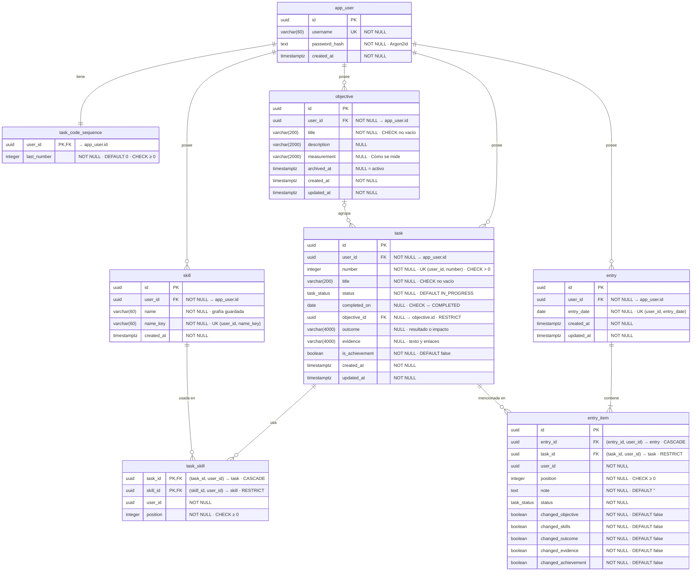

# Modelo de datos del Diario de trabajo (MVP)

> **Estado:** Aceptada · **Fecha:** 2026-11-23
> **Base:** [modelo de dominio](./modelo/dominio.md), [arquitectura](./arquitectura.md) (en especial §5.3 y §5.9 y las decisiones D-4 y D-5), [PRD del MVP](./prd/mvp.md) y [ADR-0001 — Stack tecnológico](./adr/0001-stack-tecnologico.md).
> **Qué hay aquí:** el esquema físico en PostgreSQL (tablas, columnas, tipos, claves, restricciones e índices), el `schema.prisma` que lo genera, el SQL que Prisma no sabe expresar, la correspondencia con el dominio y las consultas que sostienen las reglas del PRD.
> **Qué no hay aquí:** la especificación de la API (cuerpos y errores por endpoint), que está en [api/openapi.yaml](./api/openapi.yaml), ni el contenido del _seed_.

---

## 1. Resumen

PostgreSQL es la única base de datos y Prisma la única vía de acceso desde la API (capa `infrastructure`). El esquema tiene **nueve tablas**: siete del diario, el contador de ID de tarea y la de sesiones.

| Tabla                | Entidad de dominio                       | Qué guarda                                                                                        |
| -------------------- | ---------------------------------------- | ------------------------------------------------------------------------------------------------- |
| `app_user`           | Usuario                                  | Cuentas del _seed_ y hash Argon2id de la contraseña                                               |
| `task_code_sequence` | — (soporte de `TaskCodeSequence`)        | El último número de tarea asignado a cada usuaria (RF-15, D-5)                                    |
| `objective`          | Objetivo                                 | Título, descripción, "Cómo se mide" y fecha de archivado                                          |
| `task`               | Tarea                                    | Número secuencial, título, estado, fecha de finalización, objetivo, resultado, evidencias y logro |
| `skill`              | Competencia                              | Las competencias de la usuaria con su grafía y su clave normalizada (RF-13)                       |
| `task_skill`         | Relación tarea–competencia               | Qué competencias usa cada tarea, en el orden en que se introdujeron                               |
| `entry`              | Entrada                                  | Una fila por fecha de calendario y usuaria (RF-10)                                                |
| `entry_item`         | Elemento                                 | Tarea, nota, estado tras ese día y qué datos de detalle cambió ese guardado (RF-12, D-4)          |
| `session`            | — (infraestructura, `connect-pg-simple`) | Sesiones de `express-session` con su caducidad (RF-1)                                             |

Principios que se aplican en todo el esquema:

- **Aislamiento por usuaria (RF-3, OWASP A01).** Todas las tablas del diario llevan `user_id`. Las tablas de relación (`entry_item`, `task_skill`) usan **claves foráneas compuestas** `(x_id, user_id)`, de modo que la base rechaza enlazar una entrada de una usuaria con una tarea de otra, aunque fallara el código.
- **Fechas de calendario como `date` (RNF-4).** `entry.entry_date` y `task.completed_on` son `date`, sin hora ni zona. Las marcas técnicas (`created_at`, `updated_at`, `archived_at`) son `timestamptz` y nunca se usan en reglas de negocio ni en el informe.
- **Claves sustitutas UUID.** Cada tabla tiene `id uuid` como clave primaria. Los identificadores visibles son otros: la fecha para la entrada (`/entries/2026-03-10`) y el código `T-003` para la tarea (`/tasks/T-003`). Solo el objetivo expone su UUID (`/objectives/{id}`), porque no tiene identificador visible propio.
- **Lo derivable no se guarda.** La fecha de la última actividad, el número de entradas de una tarea, los contadores de objetivo, el resumen de la cabecera y el informe se calculan en cada consulta; a la escala de RNF-3 (300 entradas, 600 tareas) el coste es despreciable y se evita una segunda fuente de verdad.
- **La base es la red de seguridad, no la regla.** Las reglas viven en el dominio (arquitectura §5.3); las restricciones `UNIQUE`, `CHECK` y `ON DELETE RESTRICT` garantizan que ningún camino las incumpla (RNF-6).

---

## 2. Diagrama entidad-relación



La tabla `session` no aparece en el diagrama: no tiene relaciones con el resto (el `userId` va dentro del JSON de la sesión) y su forma la impone `connect-pg-simple` (§3.9).

---

## 3. Tablas

Convenciones: nombres de tablas y columnas en inglés y `snake_case`, tablas en singular (como en la arquitectura); `user` es palabra reservada en PostgreSQL, de ahí `app_user`. En Prisma, modelos en `PascalCase` y campos en `camelCase`, con `@@map`/`@map` hacia los nombres físicos (§4).

Las longitudes máximas (`varchar(n)`) son el límite de almacenamiento; los esquemas zod de `packages/shared` validan los mismos límites en la entrada para devolver `400` con un mensaje claro antes de llegar a la base (OWASP A03/A04).

### 3.1 Tipo enumerado `task_status`

| Valor         | Etiqueta en la interfaz |
| ------------- | ----------------------- |
| `IN_PROGRESS` | En curso                |
| `PAUSED`      | En pausa                |
| `COMPLETED`   | Completada              |

Es un `enum` de PostgreSQL generado por Prisma. Los mismos valores están en `TaskStatus` de `packages/shared` (arquitectura §7); las etiquetas en español solo existen en la interfaz y en el `MarkdownRenderer`.

### 3.2 `app_user`

| Columna         | Tipo          | Nulo | Por defecto         | Descripción                                                  |
| --------------- | ------------- | ---- | ------------------- | ------------------------------------------------------------ |
| `id`            | `uuid`        | No   | `gen_random_uuid()` | Clave primaria                                               |
| `username`      | `varchar(60)` | No   | —                   | Nombre de acceso del _seed_; `UNIQUE`                        |
| `password_hash` | `text`        | No   | —                   | Hash Argon2id con sus parámetros y sal embebidos (OWASP A02) |
| `created_at`    | `timestamptz` | No   | `now()`             | Marca técnica                                                |

- Solo la crea el _seed_ (RF-1: sin registro ni recuperación). Las dos usuarias de prueba existen para comprobar el aislamiento (RF-3).
- Ninguna otra tabla se borra en cascada desde aquí: todas las claves foráneas hacia `app_user` son `ON DELETE RESTRICT`. El MVP no borra usuarias.

### 3.3 `task_code_sequence`

| Columna       | Tipo      | Nulo | Por defecto | Descripción                                                 |
| ------------- | --------- | ---- | ----------- | ----------------------------------------------------------- |
| `user_id`     | `uuid`    | No   | —           | Clave primaria y foránea a `app_user.id` (`RESTRICT`)       |
| `last_number` | `integer` | No   | `0`         | Último número de tarea asignado; `CHECK (last_number >= 0)` |

- Una fila por usuaria, creada por el _seed_ junto con la usuaria.
- Es el adaptador del puerto `TaskCodeSequence` (D-5). Dentro de la misma transacción que inserta la tarea:

  ```sql
  UPDATE task_code_sequence SET last_number = last_number + 1
  WHERE user_id = $1 RETURNING last_number;
  ```

  El bloqueo de fila del `UPDATE` serializa dos creaciones simultáneas; el contador nunca baja, así que borrar `T-003` o `T-004` no libera su número (RF-15). Si la transacción se deshace, el número tampoco se consume.

- Red de seguridad: `UNIQUE (user_id, number)` en `task`. Si salta (por ejemplo, un _seed_ mal escrito), el caso de uso reintenta la transacción un número acotado de veces (RNF-5).

### 3.4 `objective`

| Columna       | Tipo            | Nulo | Por defecto         | Descripción                                                                                                                 |
| ------------- | --------------- | ---- | ------------------- | --------------------------------------------------------------------------------------------------------------------------- |
| `id`          | `uuid`          | No   | `gen_random_uuid()` | Clave primaria; identificador público en `/objectives/{id}`                                                                 |
| `user_id`     | `uuid`          | No   | —                   | Foránea a `app_user.id` (`RESTRICT`)                                                                                        |
| `title`       | `varchar(200)`  | No   | —                   | Obligatorio (RF-27); `CHECK (btrim(title) <> '')`. No es único: el informe admite dos objetivos con el mismo título (RF-36) |
| `description` | `varchar(2000)` | Sí   | —                   | Vacío si se creó solo con título desde Diario o Tareas (RF-8)                                                               |
| `measurement` | `varchar(2000)` | Sí   | —                   | "Cómo se mide"                                                                                                              |
| `archived_at` | `timestamptz`   | Sí   | —                   | `NULL` = activo; con valor = archivado (RF-28)                                                                              |
| `created_at`  | `timestamptz`   | No   | `now()`             | Marca técnica                                                                                                               |
| `updated_at`  | `timestamptz`   | No   | —                   | Marca técnica (`@updatedAt` de Prisma)                                                                                      |

- Restaurar pone `archived_at` a `NULL`. Archivar no toca las tareas: siguen vinculadas y el objetivo sigue apareciendo en el informe si tiene tareas trabajadas en el periodo (RF-36).
- `UNIQUE (id, user_id)`: no añade unicidad (ya la da `id`), pero es el destino que PostgreSQL exige para las claves foráneas compuestas; se declara igual en `task`, `skill` y `entry`.
- Los tres contadores de la tarjeta (RF-29) se calculan: `count(*)`, `count(*) FILTER (WHERE status = 'COMPLETED')` y `count(*) FILTER (WHERE is_achievement)` sobre `task` agrupando por `objective_id`.

### 3.5 `task`

| Columna          | Tipo            | Nulo | Por defecto         | Descripción                                                                                       |
| ---------------- | --------------- | ---- | ------------------- | ------------------------------------------------------------------------------------------------- |
| `id`             | `uuid`          | No   | `gen_random_uuid()` | Clave primaria interna; nunca sale por la API                                                     |
| `user_id`        | `uuid`          | No   | —                   | Foránea a `app_user.id` (`RESTRICT`)                                                              |
| `number`         | `integer`       | No   | —                   | Número de la secuencia de la usuaria; `UNIQUE (user_id, number)`, `CHECK (number > 0)`. Inmutable |
| `title`          | `varchar(200)`  | No   | —                   | `CHECK (btrim(title) <> '')` (RF-8, F3)                                                           |
| `status`         | `task_status`   | No   | `'IN_PROGRESS'`     | Estado actual (RF-8)                                                                              |
| `completed_on`   | `date`          | Sí   | —                   | Fecha de finalización; `CHECK ((status = 'COMPLETED') = (completed_on IS NOT NULL))` (RF-24)      |
| `objective_id`   | `uuid`          | Sí   | —                   | Foránea a `objective.id`, `ON DELETE RESTRICT` (RF-30); `NULL` = "Sin objetivo"                   |
| `outcome`        | `varchar(4000)` | Sí   | —                   | Resultado o impacto; `NULL` si falta (el informe muestra la indicación para añadirlo, RF-34)      |
| `evidence`       | `varchar(4000)` | Sí   | —                   | Evidencias: texto libre con enlaces que pinta el navegador; el servidor no los visita (OWASP A10) |
| `is_achievement` | `boolean`       | No   | `false`             | Marca de logro                                                                                    |
| `created_at`     | `timestamptz`   | No   | `now()`             | Marca técnica (la "fecha de creación" del dominio)                                                |
| `updated_at`     | `timestamptz`   | No   | —                   | Marca técnica                                                                                     |

- **El código `T-003` no se guarda**: lo forma `TaskCode` a partir de `number` (prefijo `T-` y al menos tres cifras, sin límite superior). Al resolver `/tasks/{code}`, el dominio solo acepta la forma canónica (`T-003`, no `T-3` ni `T-0003`) y busca por `(user_id, number)`.
- **El `CHECK` de RF-24** es la red de seguridad de la invariante que ya comprueba la entidad `Task`: si un camino olvidara borrar `completed_on` al salir de `Completada`, la transacción entera se deshace.
- **Cadenas vacías.** El dominio guarda `outcome` y `evidence` recortados y convierte la cadena vacía en `NULL`, para que "falta el resultado" tenga un único valor y la comparación de "dato cambiado" (RF-12) no distinga `''` de `NULL`.
- **Inquilino del objetivo.** La relación con `objective` es de una sola columna (§6, decisión DM-5): que el objetivo sea de la misma usuaria lo garantiza el caso de uso, que lo busca por `(id, user_id)` y responde `404` si no existe (D-8), y lo prueba un test de contrato con las dos usuarias del _seed_.
- **Borrado** (RF-25): `entry_item.task_id` es `ON DELETE RESTRICT`, así que una tarea mencionada por alguna entrada no se puede borrar ni por error; sus filas de `task_skill` sí se borran en cascada.

### 3.6 `skill`

| Columna      | Tipo          | Nulo | Por defecto         | Descripción                                                                                         |
| ------------ | ------------- | ---- | ------------------- | --------------------------------------------------------------------------------------------------- |
| `id`         | `uuid`        | No   | `gen_random_uuid()` | Clave primaria                                                                                      |
| `user_id`    | `uuid`        | No   | —                   | Foránea a `app_user.id` (`RESTRICT`)                                                                |
| `name`       | `varchar(60)` | No   | —                   | Grafía con la que se creó y con la que se muestra ("Kubernetes"); `CHECK (btrim(name) <> '')`       |
| `name_key`   | `varchar(60)` | No   | —                   | Clave de comparación: `name` recortado y en minúsculas ("kubernetes"); `UNIQUE (user_id, name_key)` |
| `created_at` | `timestamptz` | No   | `now()`             | Marca técnica                                                                                       |

- `name_key` lo calcula `SkillNormalizer` en el dominio, así que la base y el dominio comparan con la misma función (decisión DM-3). Guardar "kubernetes" busca `name_key = 'kubernetes'`, encuentra "Kubernetes" y lo reutiliza (RF-13); dos inserciones concurrentes de la misma competencia chocan con el `UNIQUE` y se resuelven con `INSERT … ON CONFLICT (user_id, name_key) DO NOTHING` seguido de un `SELECT`.
- **Competencias conocidas** = las que usa al menos una tarea. Cuando una competencia deja de usarse, el mismo caso de uso que quita el último vínculo la borra (decisión DM-4); `task_skill.skill_id` es `RESTRICT`, de modo que nunca se borra una en uso.
- Sugerencias (RF-13): `WHERE user_id = $1 AND name_key LIKE '%' || $2 || '%'` con el texto escrito normalizado y los comodines `%` y `_` escapados. A esta escala no hace falta índice de trigramas.

### 3.7 `task_skill`

| Columna    | Tipo      | Nulo | Descripción                                                                                     |
| ---------- | --------- | ---- | ----------------------------------------------------------------------------------------------- |
| `task_id`  | `uuid`    | No   | Parte de la clave primaria; `(task_id, user_id)` → `task (id, user_id)`, `ON DELETE CASCADE`    |
| `skill_id` | `uuid`    | No   | Parte de la clave primaria; `(skill_id, user_id)` → `skill (id, user_id)`, `ON DELETE RESTRICT` |
| `user_id`  | `uuid`    | No   | Usuaria propietaria; forma parte de las dos foráneas compuestas                                 |
| `position` | `integer` | No   | Orden en que se introdujeron las competencias en la tarea; `CHECK (position >= 0)`              |

- La clave primaria `(task_id, skill_id)` impide repetir una competencia en una tarea ("Kubernetes" y "KUBERNETES" acaban en el mismo `skill_id`, RF-13).
- `position` hace determinista el orden en que se pintan las competencias de una tarea (tarjeta de logro del informe, RF-39). El orden de la sección Fortalezas no depende de él: se fija con las reglas de RF-35.
- Índice adicional por `skill_id`, para contar tareas por competencia (Fortalezas) y para el filtro por competencia de S2.

### 3.8 `entry`

| Columna      | Tipo          | Nulo | Por defecto         | Descripción                                                       |
| ------------ | ------------- | ---- | ------------------- | ----------------------------------------------------------------- |
| `id`         | `uuid`        | No   | `gen_random_uuid()` | Clave primaria interna; la API identifica la entrada por la fecha |
| `user_id`    | `uuid`        | No   | —                   | Foránea a `app_user.id` (`RESTRICT`)                              |
| `entry_date` | `date`        | No   | —                   | Fecha de calendario; `UNIQUE (user_id, entry_date)` (RF-10)       |
| `created_at` | `timestamptz` | No   | `now()`             | Marca técnica                                                     |
| `updated_at` | `timestamptz` | No   | —                   | Marca técnica                                                     |

- `entry_date` es inmutable: editar una entrada solo cambia sus elementos (RF-14).
- **"No posterior a hoy" (RF-7) no es una restricción de la base**: "hoy" es la fecha local del navegador (`X-Client-Date`, D-3), que la base no conoce; un `CHECK (entry_date <= CURRENT_DATE)` usaría la zona del servidor y además sería inválido en PostgreSQL por no ser inmutable. La regla vive solo en `SaveDailyEntry`.
- El índice único `(user_id, entry_date)` sirve también para el listado descendente (RF-16) y para los rangos del informe (`entry_date BETWEEN $from AND $to`, inclusivo en los dos extremos, RNF-4).
- Sin elementos no hay entrada: si al editar se quitan todos, el caso de uso rechaza la operación (el editor exige al menos un elemento, RF-7) y para vaciarla hay que eliminarla.

### 3.9 `entry_item`

| Columna               | Tipo          | Nulo | Por defecto         | Descripción                                                                                                                                                   |
| --------------------- | ------------- | ---- | ------------------- | ------------------------------------------------------------------------------------------------------------------------------------------------------------- |
| `id`                  | `uuid`        | No   | `gen_random_uuid()` | Clave primaria interna                                                                                                                                        |
| `entry_id`            | `uuid`        | No   | —                   | `(entry_id, user_id)` → `entry (id, user_id)`, `ON DELETE CASCADE`                                                                                            |
| `task_id`             | `uuid`        | No   | —                   | `(task_id, user_id)` → `task (id, user_id)`, `ON DELETE RESTRICT` (RF-25)                                                                                     |
| `user_id`             | `uuid`        | No   | —                   | Usuaria propietaria; forma parte de las dos foráneas compuestas                                                                                               |
| `position`            | `integer`     | No   | —                   | Orden de guardado dentro de la entrada (0, 1, 2…); en la fusión, los nuevos van al final; `CHECK (position >= 0)`                                             |
| `note`                | `text`        | No   | `''`                | Nota del día; opcional (RNF-1). Sin límite en la columna porque la fusión concatena notas (RF-10); cada nota que entra por la API se limita a 4000 caracteres |
| `status`              | `task_status` | No   | —                   | Estado de la tarea tras ese día                                                                                                                               |
| `changed_objective`   | `boolean`     | No   | `false`             | Este elemento cambió el objetivo de la tarea (RF-12)                                                                                                          |
| `changed_skills`      | `boolean`     | No   | `false`             | Este elemento cambió las competencias                                                                                                                         |
| `changed_outcome`     | `boolean`     | No   | `false`             | Este elemento cambió el resultado o impacto                                                                                                                   |
| `changed_evidence`    | `boolean`     | No   | `false`             | Este elemento cambió las evidencias                                                                                                                           |
| `changed_achievement` | `boolean`     | No   | `false`             | Este elemento cambió la marca de logro                                                                                                                        |

- `UNIQUE (entry_id, task_id)`: una tarea, una vez por entrada (RF-11); la fusión (RF-10) actualiza el elemento existente en vez de insertar otro.
- Índice por `task_id`: línea de tiempo de una tarea (RF-21), última actividad y número de entradas (RF-20) y las comprobaciones de RF-12 y RF-14.
- **Los `changed_*` son los `changedFields` de D-4.** Al guardar, se calcula cada uno comparando el valor del elemento con el que tenía la tarea en ese momento ("un dato cuenta como cambiado si difería", RF-12). Reglas de mantenimiento:
  - **Fusión en la misma fecha** (RF-10): el elemento fusionado queda con `changed_x = anterior OR nuevo`.
  - **Edición de la entrada** (RF-14): un elemento que se conserva mantiene sus `changed_*` anteriores y suma (`OR`) los que cambie en esta edición; uno que se quita se borra con sus marcas.
  - **Cambios desde Tareas** (RF-23): no crean ni tocan elementos, así que nunca activan la protección.
- **No se guarda una instantánea de los valores de detalle** en el elemento (decisión DM-1): la protección de RF-12 solo necesita saber si una entrada posterior _cambió_ el dato, y el recálculo de RF-14 no toca los datos de detalle. El valor vigente vive solo en `task`. El estado sí se guarda (`status`), porque RF-14 recalcula a partir de él y la línea de tiempo marca sus cambios (RF-21).

### 3.10 `session`

Tabla de `connect-pg-simple`, con la forma exacta que espera la librería:

| Columna  | Tipo           | Nulo | Descripción                                                                                                         |
| -------- | -------------- | ---- | ------------------------------------------------------------------------------------------------------------------- |
| `sid`    | `varchar`      | No   | Clave primaria: identificador de sesión (el valor firmado va en la cookie)                                          |
| `sess`   | `json`         | No   | Datos de la sesión; solo `{ userId }` además de la propia cookie                                                    |
| `expire` | `timestamp(6)` | No   | Caducidad; con `rolling: true` y `maxAge` de 30 min se renueva en cada petición (RF-1); índice `IDX_session_expire` |

- La declara `schema.prisma` y la crean las migraciones, para que Prisma no la vea como deriva del esquema; `connect-pg-simple` se configura con `createTableIfMissing: false`.
- La limpieza de sesiones caducadas la hace la propia librería (`pruneSessionInterval`). Ningún repositorio del dominio lee esta tabla.

---

## 4. Esquema Prisma (`apps/api/prisma/schema.prisma`)

Es la fuente de las migraciones (`prisma migrate`). Lo que Prisma no sabe expresar va en el SQL de §5.

```prisma
generator client {
  provider = "prisma-client-js"
}

datasource db {
  provider = "postgresql"
  url      = env("DATABASE_URL")
}

enum TaskStatus {
  IN_PROGRESS
  PAUSED
  COMPLETED

  @@map("task_status")
}

model AppUser {
  id           String   @id @default(uuid()) @db.Uuid
  username     String   @unique @db.VarChar(60)
  passwordHash String   @map("password_hash")
  createdAt    DateTime @default(now()) @map("created_at") @db.Timestamptz(3)

  taskCodeSequence TaskCodeSequence?
  objectives       Objective[]
  tasks            Task[]
  skills           Skill[]
  entries          Entry[]

  @@map("app_user")
}

model TaskCodeSequence {
  userId     String @id @map("user_id") @db.Uuid
  lastNumber Int    @default(0) @map("last_number")

  user AppUser @relation(fields: [userId], references: [id], onDelete: Restrict)

  @@map("task_code_sequence")
}

model Objective {
  id          String    @id @default(uuid()) @db.Uuid
  userId      String    @map("user_id") @db.Uuid
  title       String    @db.VarChar(200)
  description String?   @db.VarChar(2000)
  measurement String?   @db.VarChar(2000)
  archivedAt  DateTime? @map("archived_at") @db.Timestamptz(3)
  createdAt   DateTime  @default(now()) @map("created_at") @db.Timestamptz(3)
  updatedAt   DateTime  @updatedAt @map("updated_at") @db.Timestamptz(3)

  user  AppUser @relation(fields: [userId], references: [id], onDelete: Restrict)
  tasks Task[]

  @@unique([id, userId])
  @@index([userId])
  @@map("objective")
}

model Task {
  id            String     @id @default(uuid()) @db.Uuid
  userId        String     @map("user_id") @db.Uuid
  number        Int
  title         String     @db.VarChar(200)
  status        TaskStatus @default(IN_PROGRESS)
  completedOn   DateTime?  @map("completed_on") @db.Date
  objectiveId   String?    @map("objective_id") @db.Uuid
  outcome       String?    @db.VarChar(4000)
  evidence      String?    @db.VarChar(4000)
  isAchievement Boolean    @default(false) @map("is_achievement")
  createdAt     DateTime   @default(now()) @map("created_at") @db.Timestamptz(3)
  updatedAt     DateTime   @updatedAt @map("updated_at") @db.Timestamptz(3)

  user      AppUser     @relation(fields: [userId], references: [id], onDelete: Restrict)
  objective Objective?  @relation(fields: [objectiveId], references: [id], onDelete: Restrict)
  items     EntryItem[]
  skills    TaskSkill[]

  @@unique([userId, number])
  @@unique([id, userId])
  @@index([userId, completedOn])
  @@index([objectiveId])
  @@map("task")
}

model Skill {
  id        String   @id @default(uuid()) @db.Uuid
  userId    String   @map("user_id") @db.Uuid
  name      String   @db.VarChar(60)
  nameKey   String   @map("name_key") @db.VarChar(60)
  createdAt DateTime @default(now()) @map("created_at") @db.Timestamptz(3)

  user  AppUser     @relation(fields: [userId], references: [id], onDelete: Restrict)
  tasks TaskSkill[]

  @@unique([userId, nameKey])
  @@unique([id, userId])
  @@map("skill")
}

model TaskSkill {
  taskId   String @map("task_id") @db.Uuid
  skillId  String @map("skill_id") @db.Uuid
  userId   String @map("user_id") @db.Uuid
  position Int

  task  Task  @relation(fields: [taskId, userId], references: [id, userId], onDelete: Cascade)
  skill Skill @relation(fields: [skillId, userId], references: [id, userId], onDelete: Restrict)

  @@id([taskId, skillId])
  @@index([skillId])
  @@map("task_skill")
}

model Entry {
  id        String   @id @default(uuid()) @db.Uuid
  userId    String   @map("user_id") @db.Uuid
  entryDate DateTime @map("entry_date") @db.Date
  createdAt DateTime @default(now()) @map("created_at") @db.Timestamptz(3)
  updatedAt DateTime @updatedAt @map("updated_at") @db.Timestamptz(3)

  user  AppUser     @relation(fields: [userId], references: [id], onDelete: Restrict)
  items EntryItem[]

  @@unique([userId, entryDate])
  @@unique([id, userId])
  @@map("entry")
}

model EntryItem {
  id                 String     @id @default(uuid()) @db.Uuid
  entryId            String     @map("entry_id") @db.Uuid
  taskId             String     @map("task_id") @db.Uuid
  userId             String     @map("user_id") @db.Uuid
  position           Int
  note               String     @default("")
  status             TaskStatus
  changedObjective   Boolean    @default(false) @map("changed_objective")
  changedSkills      Boolean    @default(false) @map("changed_skills")
  changedOutcome     Boolean    @default(false) @map("changed_outcome")
  changedEvidence    Boolean    @default(false) @map("changed_evidence")
  changedAchievement Boolean    @default(false) @map("changed_achievement")

  entry Entry @relation(fields: [entryId, userId], references: [id, userId], onDelete: Cascade)
  task  Task  @relation(fields: [taskId, userId], references: [id, userId], onDelete: Restrict)

  @@unique([entryId, taskId])
  @@index([taskId])
  @@map("entry_item")
}

model Session {
  sid    String   @id @db.VarChar
  sess   Json     @db.Json
  expire DateTime @db.Timestamp(6)

  @@index([expire], map: "IDX_session_expire")
  @@map("session")
}
```

Notas sobre Prisma:

- `@db.Date` llega al cliente como un `Date` de JavaScript a medianoche UTC. **Solo el adaptador de infraestructura** lo convierte, en las dos direcciones, con `CalendarDate.fromIso(d.toISOString().slice(0, 10))` y `new Date(\`${date}T00:00:00Z\`)`; nunca con métodos locales (`getDate()`, `toLocaleDateString()`). Un test de integración en zona no UTC (`TZ=America/Los_Angeles`) lo comprueba (arquitectura §12).
- Los repositorios devuelven entidades del dominio, nunca tipos de `@prisma/client` (ADR-0002).
- Las relaciones compuestas (`fields: [taskId, userId]`) reutilizan `userId` en dos relaciones del mismo modelo; Prisma lo permite y genera las dos claves foráneas compuestas.

---

## 5. SQL complementario de la migración inicial

Prisma no representa restricciones `CHECK`. Se añaden a mano al final de la migración inicial (`prisma migrate dev --create-only`, editar y aplicar); Prisma las conserva en migraciones posteriores porque no las compara.

```sql
-- RF-24: completion date exists if and only if the task is completed
ALTER TABLE task
  ADD CONSTRAINT task_completed_on_iff_completed
  CHECK ((status = 'COMPLETED') = (completed_on IS NOT NULL));

-- RF-15: task numbers start at 1
ALTER TABLE task
  ADD CONSTRAINT task_number_positive CHECK (number > 0);

-- Mandatory titles and names cannot be blank
ALTER TABLE task
  ADD CONSTRAINT task_title_not_blank CHECK (btrim(title) <> '');
ALTER TABLE objective
  ADD CONSTRAINT objective_title_not_blank CHECK (btrim(title) <> '');
ALTER TABLE skill
  ADD CONSTRAINT skill_name_not_blank CHECK (btrim(name) <> '');
ALTER TABLE skill
  ADD CONSTRAINT skill_name_key_normalized CHECK (name_key <> '' AND name_key = btrim(name_key));

-- Positions and counters are never negative
ALTER TABLE task_skill
  ADD CONSTRAINT task_skill_position_non_negative CHECK (position >= 0);
ALTER TABLE entry_item
  ADD CONSTRAINT entry_item_position_non_negative CHECK (position >= 0);
ALTER TABLE task_code_sequence
  ADD CONSTRAINT task_code_sequence_non_negative CHECK (last_number >= 0);
```

No se añade un `CHECK (name_key = lower(name_key))`: `lower()` de PostgreSQL y `toLowerCase()` de JavaScript pueden diferir en caracteres poco comunes según la _collation_ del servidor, y la clave la manda el dominio (DM-3).

Las migraciones se versionan en `apps/api/prisma/migrations/` y se aplican con `prisma migrate deploy` en el servicio de arranque de `docker compose` y en el `Job` de Kubernetes (arquitectura §8). Un test de integración contra PostgreSQL real comprueba que cada restricción de §3 y §5 rechaza la fila que debe rechazar.

---

## 6. Correspondencia con el dominio

| Dominio (`apps/api/src/domain`)           | Persistencia                                                                     |
| ----------------------------------------- | -------------------------------------------------------------------------------- |
| `User`                                    | `app_user`                                                                       |
| `Entry` (identificada por `CalendarDate`) | `entry` + sus `entry_item`, ordenados por `position`                             |
| `EntryItem`                               | `entry_item` (tarea por `TaskCode`, nota, estado, `changedFields` = `changed_*`) |
| `Task`                                    | `task` + `task_skill` (ordenadas por `position`) + `skill.name`                  |
| `TaskCode`                                | `task.number` (el formato `T-NNN` solo existe en el dominio)                     |
| `TaskStatus`                              | enum `task_status`                                                               |
| `Objective` (`archived: boolean`)         | `objective` (`archived_at IS NOT NULL`)                                          |
| `Skill`                                   | `skill` (`name`, `name_key`)                                                     |
| `CalendarDate`                            | columnas `date` (`entry_date`, `completed_on`)                                   |
| `TaskCodeSequence` (puerto)               | `task_code_sequence`                                                             |
| `UnitOfWork` (puerto)                     | `prisma.$transaction(…)` interactiva, nivel `READ COMMITTED`                     |
| Sesión (no es dominio)                    | `session`                                                                        |

---

## 7. Cómo sostiene el esquema las reglas

Todas las operaciones de escritura son **una transacción** (`UnitOfWork`, RNF-5): o se guarda la entrada completa con sus tareas, objetivos y competencias nuevos, o nada.

### 7.1 Guardar la entrada del día (RF-10, RF-11, RF-12)

Dentro de la transacción de `SaveDailyEntry`, en este orden:

1. Crear los objetivos nuevos (solo título) y las tareas nuevas (`task_code_sequence` + `INSERT task`).
2. Obtener o crear la entrada de la fecha **con bloqueo**, para que dos pestañas que guardan la misma fecha a la vez se serialicen en vez de chocar:

   ```sql
   INSERT INTO entry (id, user_id, entry_date, updated_at)
   VALUES (gen_random_uuid(), $1, $2, now())
   ON CONFLICT (user_id, entry_date) DO NOTHING;

   SELECT id FROM entry WHERE user_id = $1 AND entry_date = $2 FOR UPDATE;
   ```

3. Bloquear las tareas afectadas en orden de `id` (evita interbloqueos entre dos guardados con tareas en común) y leer su estado actual:

   ```sql
   SELECT * FROM task WHERE user_id = $1 AND id = ANY($2) ORDER BY id FOR UPDATE;
   ```

4. Para cada tarea, leer lo que deciden las entradas **posteriores** a la fecha (RF-12):

   ```sql
   SELECT
     count(*) > 0                                 AS mentioned_later,
     coalesce(bool_or(ei.changed_objective), false)   AS objective_changed_later,
     coalesce(bool_or(ei.changed_skills), false)      AS skills_changed_later,
     coalesce(bool_or(ei.changed_outcome), false)     AS outcome_changed_later,
     coalesce(bool_or(ei.changed_evidence), false)    AS evidence_changed_later,
     coalesce(bool_or(ei.changed_achievement), false) AS achievement_changed_later
   FROM entry_item ei
   JOIN entry e ON e.id = ei.entry_id
   WHERE ei.task_id = $1 AND e.entry_date > $2;
   ```

   Con eso y el elemento del formulario, `EntryMerger` y `TaskStateProjector` deciden: el estado (y `completed_on = entry_date` si es `COMPLETED`) solo se aplica si `mentioned_later` es falso; cada dato de detalle, solo si su `*_changed_later` es falso.

5. Escribir `entry_item` (insertar o fusionar), `task`, `task_skill` y `skill` (creando o borrando las que haga falta), y hacer `COMMIT`. Si cualquier paso falla, incluido un `CHECK`, se deshace todo.

### 7.2 Eliminar una entrada o quitar un elemento (RF-14)

Para cada tarea afectada, tras borrar las filas (la de `entry` arrastra sus `entry_item` por `CASCADE`):

```sql
SELECT ei.status, e.entry_date
FROM entry_item ei
JOIN entry e ON e.id = ei.entry_id
WHERE ei.task_id = $1
ORDER BY e.entry_date DESC
LIMIT 1;
```

Si devuelve una fila, `status` pasa a ser el de esa fila y `completed_on` su `entry_date` si es `COMPLETED` (`NULL` si no). Si no devuelve nada, la tarea se queda como estaba. No se tocan objetivo, competencias, resultado, evidencias ni logro. Como una tarea solo puede tener un elemento por entrada y una entrada por fecha, `entry_date` es única por tarea y el `ORDER BY` no tiene empates.

### 7.3 Lecturas

| Necesidad                        | Consulta (siempre con `user_id = $1`)                                                                                                                                                                                                                         |
| -------------------------------- | ------------------------------------------------------------------------------------------------------------------------------------------------------------------------------------------------------------------------------------------------------------- |
| Lista de tareas (RF-20)          | `task` con `LEFT JOIN` a un agregado `max(entry_date)`, `count(*)` por `task_id`; `ORDER BY last_activity DESC NULLS LAST, number ASC`                                                                                                                        |
| Línea de tiempo (RF-21)          | `entry_item` + `entry` de la tarea, `ORDER BY entry_date DESC`; los indicadores de cambio de estado se calculan en el cliente comparando cada elemento con el anterior                                                                                        |
| Historial (RF-16)                | `entry` `ORDER BY entry_date DESC` con sus `entry_item` (por `position`), tarea, objetivo y competencias                                                                                                                                                      |
| Resumen de la cabecera (RF-4)    | `count(*)` de `entry`; `count(*)` y `count(*) FILTER (WHERE is_achievement)` de `task`                                                                                                                                                                        |
| Contadores de objetivo (RF-29)   | Agregado de `task` por `objective_id` (§3.4), sin filtro de periodo                                                                                                                                                                                           |
| Borrado bloqueado (RF-25, RF-30) | `EXISTS` en `entry_item` por `task_id` / en `task` por `objective_id` antes de borrar, para devolver `409`; el `RESTRICT` lo respalda                                                                                                                         |
| Informe (RF-33…RF-39)            | Tres lecturas: entradas del rango con sus elementos; tareas mencionadas en el rango **o** con `completed_on` en el rango (índice `(user_id, completed_on)`), con competencias; y los objetivos de esas tareas. El resto lo calcula `ReportBuilder` en memoria |
| Búsqueda y filtros (RF-26, S2)   | `ILIKE` con comodines escapados sobre título, resultado, evidencias, `skill.name` y `entry_item.note`; sin índices de texto a esta escala                                                                                                                     |

El orden que ve la usuaria en el informe **nunca** depende de un `ORDER BY` de la base: las colaciones del servidor podrían cambiar el orden de los textos entre entornos. `ReportBuilder` y `MarkdownRenderer` ordenan con comparadores explícitos (arquitectura §5.3 y §12). En las demás lecturas, los `ORDER BY` solo usan fechas y números, nunca textos.

---

## 8. Volumen e índices

A la escala de RNF-3 (300 entradas, unos 1 000 elementos, 600 tareas, unas 100 competencias), toda la base de una usuaria ocupa unos pocos megabytes y cabe en memoria. Por eso solo hay los índices que exigen las restricciones y los de acceso por usuaria:

| Índice                                                          | Origen                     | Para qué                                                         |
| --------------------------------------------------------------- | -------------------------- | ---------------------------------------------------------------- |
| `entry (user_id, entry_date)` único                             | RF-10                      | Una entrada por fecha, historial descendente, rangos del informe |
| `entry_item (entry_id, task_id)` único                          | RF-11                      | Una tarea por entrada; elementos de una entrada                  |
| `entry_item (task_id)`                                          | RF-12, RF-14, RF-20, RF-21 | Historial de una tarea                                           |
| `task (user_id, number)` único                                  | RF-15                      | ID estables; búsqueda por código                                 |
| `task (user_id, completed_on)`                                  | RF-33, RF-34               | Tareas completadas en el periodo                                 |
| `task (objective_id)`                                           | RF-29, RF-30               | Contadores y bloqueo de borrado del objetivo                     |
| `skill (user_id, name_key)` único                               | RF-13                      | Normalización y sugerencias                                      |
| `task_skill (task_id, skill_id)` PK, `(skill_id)`               | RF-13, RF-35               | Competencias de una tarea; tareas de una competencia             |
| `objective (user_id)`                                           | RF-27…RF-31                | Lista de objetivos                                               |
| `(id, user_id)` únicos en `entry`, `task`, `skill`, `objective` | RF-3                       | Destino de las foráneas compuestas                               |
| `session (expire)`                                              | RF-1                       | Limpieza de sesiones caducadas                                   |

---

## 9. Datos semilla

El _seed_ (`apps/api/prisma/seed.ts`) se ejecuta en cada despliegue y tiene que ser **idempotente** (ADR-0001): si se pierde el volumen en Kubernetes, vuelve a dejar la base igual.

- Usa **UUID fijos** escritos en el propio _seed_ para todas las filas y `upsert` por esa clave; para las tareas, además, por `(user_id, number)`, y para las competencias, por `(user_id, name_key)`. Ejecutarlo dos veces no duplica nada.
- Deja `task_code_sequence.last_number` igual al mayor `number` sembrado de cada usuaria (`GREATEST(last_number, max(number))`, para no bajarlo nunca).
- Crea las dos usuarias de prueba con contraseñas tomadas de variables de entorno (`SEED_USER1_PASSWORD`, `SEED_USER2_PASSWORD`), hasheadas con Argon2id; ningún secreto en el repositorio (RNF-7).
- Los datos de la usuaria principal cubren los ejemplos de aceptación del PRD (fusión, relleno de fechas pasadas, tareas sin entradas, objetivo archivado con trabajo en el periodo, empates del informe) para que el test byte a byte de RF-39 tenga sobre qué ejecutarse.
- Todos los datos son ficticios (RNF-7).

---

## 10. Decisiones de este documento

Concretan lo que la arquitectura dejó abierto. Revisadas y aprobadas por la propietaria el 2026-11-23; cambiar cualquiera de ellas exige un ADR propio que la sustituya.

| #    | Decisión                                                                                                                         | Motivo                                                                                                                                                                                                                           | Alternativa descartada                                                                                                     |
| ---- | -------------------------------------------------------------------------------------------------------------------------------- | -------------------------------------------------------------------------------------------------------------------------------------------------------------------------------------------------------------------------------- | -------------------------------------------------------------------------------------------------------------------------- |
| DM-1 | `entry_item` guarda el estado y **solo las marcas** `changed_*` de los datos de detalle, no sus valores                          | RF-12 solo pregunta si una entrada posterior cambió el dato, y RF-14 no recalcula los datos de detalle; guardar los valores crearía una segunda fuente de verdad                                                                 | Instantánea completa de objetivo, competencias, resultado, evidencias y logro en cada elemento                             |
| DM-2 | Claves primarias UUID; identificadores públicos: fecha (entrada), código `T-NNN` (tarea) y UUID (objetivo)                       | No revela volúmenes ni permite enumerar objetivos; las rutas siguen siendo legibles donde la usuaria las ve                                                                                                                      | `bigint` autoincremental expuesto en la API                                                                                |
| DM-3 | Unicidad de competencias con una columna `name_key` calculada por el dominio, en lugar de `UNIQUE (user_id, lower(name))`        | Prisma no expresa índices sobre expresiones; con `name_key` la base y `SkillNormalizer` comparan exactamente con la misma función                                                                                                | Índice de expresión añadido a mano (Prisma lo ve como deriva) o tipo `citext` (otra extensión y otra regla de comparación) |
| DM-4 | Una competencia que ninguna tarea usa se borra en la misma transacción                                                           | "Competencias conocidas" (RF-13) son las que están en uso; así no se sugieren grafías de competencias ya abandonadas                                                                                                             | Conservar las competencias huérfanas indefinidamente                                                                       |
| DM-5 | Claves foráneas compuestas `(x_id, user_id)` en `entry_item` y `task_skill`; `task.objective_id` es de una sola columna          | Aislamiento por cualquier camino (RF-3, RNF-6) donde Prisma lo permite; Prisma no admite una relación opcional compuesta con una columna obligatoria, así que el objetivo se protege en el caso de uso y con un test de contrato | Sin foráneas compuestas (el aislamiento dependería solo del código) o _triggers_                                           |
| DM-6 | `task_skill.position` guarda el orden de introducción de las competencias                                                        | Sin él, el orden de las competencias de una tarea en el Markdown dependería del plan de la consulta y rompería RF-39                                                                                                             | Ordenar alfabéticamente (cambia lo que escribió la usuaria) o sin orden definido                                           |
| DM-7 | Límites de longitud: títulos 200, nombre de competencia 60, descripción y "Cómo se mide" 2000, resultado, evidencias y nota 4000 | El PRD no fija límites; estos cubren de sobra el uso previsto y acotan el tamaño de las peticiones (OWASP A04)                                                                                                                   | `text` sin límite en todas las columnas                                                                                    |
| DM-8 | La tabla `session` la crean las migraciones de Prisma, no `connect-pg-simple`                                                    | Una sola herramienta gestiona el esquema y no hay deriva entre la base y `schema.prisma`                                                                                                                                         | `createTableIfMissing: true` en `connect-pg-simple`                                                                        |
